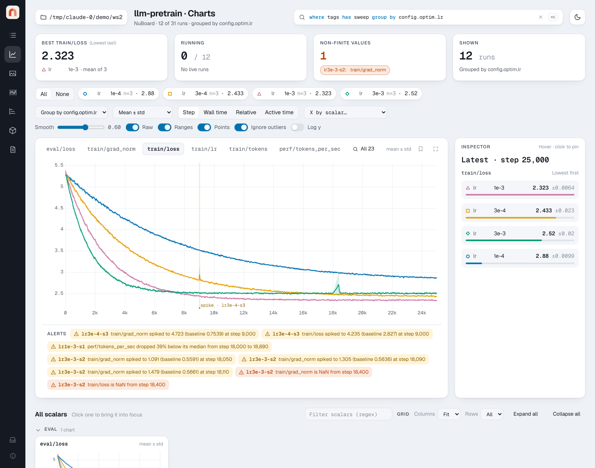

<p align="center"></p>

<h1 align="center">NuBoard</h1>

<p align="center"><b>Experiment tracking that lives in a folder.</b><br>
Log from Python with three calls. Every run is a folder. View thousands of runs in your browser.</p>



```python
import nuboard as nb

with nb.init("my-project", name="baseline", config={"lr": 3e-4}) as run:
    for step in range(10_000):
        loss = train_step()
        run.add_scalar({"train/loss": loss}, step=step)  # ~3 µs, never blocks training
```

```bash
nuboard up experiments        # http://localhost:6070
```

## Why

- **No setup.** No account, no server, no database. `pip install nuboard` adds
  no dependencies to your training environment (standard library only).
- **Folder-contained.** Each run is one folder (`run.json`, an append-only
  binary log, a media pack, a Parquet file at the end). Copy it, rsync it, zip
  it, delete it.
- **Fast.** Logging is a deque append; a background thread writes columnar
  frames. The viewer reads a million points in about a tenth of a second and
  lists thousands of runs instantly.
- **Records what you forget.** Config, git commit and uncommitted diff,
  installed packages, GPUs, command line, rank, console output and CPU, memory
  and GPU use, automatically.
- **Crash-safe.** A killed process loses at most the last second of data; torn
  writes are ignored; crashes are marked with their traceback.

## Quick start

```bash
# nuboard is not on PyPI yet: install the wheel that ships next to this repository
uv tool install "nuboard-0.16.0-py3-none-any.whl[viewer]"
nuboard demo demo-runs --up --open    # 4 projects, 31 runs, one live run
```

Then try `where tags has "sweep" group by config.optim.lr` in the query bar and
open the Charts page. The [quickstart](docs/quickstart.md) has a tour, and
[installation](docs/installation.md) covers building from source.

## What's in 0.13

| Area | Included |
| --- | --- |
| Python API | `init` (+ resume, fork, ranks), `add_scalar`, `add_file`, `add_text`, `add_image`, `add_audio`, `add_video`, `add_figure`, `add_pr_curve`, `add_histogram`, `add_table`, `add_point_cloud`, `add_html`, `add_artifact` (copies or references), `use_artifact` (across projects), `nb.add_artifact`, `nb.get_artifact`, `finish`, context manager; system scalars (CPU, memory, GPU) and console capture |
| Storage | documented [log format](docs/reference/format.md), Parquet compaction with zoom levels, versioned artifacts, collections |
| Analysis | `nb.load("project").scalars("loss", group_by="config.lr")` returns Arrow tables; properties, collections and alerts per run |
| Runs | query language, stars, Markdown notes, archive, typed properties, tag editing, column chooser, collections, saved views, run details and config/file diffs |
| Charts | grouped lines with bands, smoothing, zoom, linked crosshair, inspector, live updates, alerts strip, x axis by any scalar (tokens, epochs), solo or show all series |
| Media | images, video, audio (waveform + spectrogram player with notes, or the browser's player), per-example tables compared across steps, PR curves, distributions over steps, point clouds with axes, text, HTML, and interactive Plotly, Vega-Lite and Bokeh figures; filter by kind, a step slider per card, best-scalar step, configurable grid |
| Reports | Markdown reports that embed logged items, live charts and plot snapshots; export as HTML or a zip, print to PDF |
| Sweeps | parallel coordinates with brushing, scatter per parameter, rank correlation, best runs |
| Timeline | runs over wall-clock time, packed concurrency view, crash, alert and artifact markers |
| Artifacts | versions, files, metadata and a lineage graph |
| Health alerts | NaN/Inf, loss and gradient spikes, throughput drops, per scalar and rank |
| CLI | `nuboard up`, `demo`, `ls`, `compact`, `artifact add`/`ls`/`show`, `import-tensorboard` (TensorBoard logs to runs) |

See the [roadmap](docs/roadmap.md) and the [changelog](docs/changelog.md).

## Documentation

The docs are a [MkDocs](https://www.mkdocs.org/) site in `docs/`:

```bash
uv run mkdocs serve    # http://localhost:8000
```

- [Installation](docs/installation.md) and [Quickstart](docs/quickstart.md)
- [Logging from Python](docs/guide/logging.md), [Using the viewer](docs/guide/viewer.md),
  [Sweeps](docs/guide/sweeps.md), [Health alerts](docs/guide/alerts.md),
  [Artifacts and lineage](docs/guide/artifacts.md), [Analysis API](docs/guide/analysis.md),
  [Distributed training](docs/guide/distributed.md),
  [Importing from TensorBoard](docs/guide/tensorboard.md)
- Reference: [query language](docs/reference/query.md), [file format](docs/reference/format.md),
  [architecture](docs/reference/architecture.md), [development](docs/reference/development.md)

## Development

```bash
uv sync                                              # Python + dev tools
(cd frontend && pnpm install && pnpm build)          # builds the viewer into src/nuboard/static/
uv run pytest && uv run ruff check . && uv run pyright
(cd frontend && pnpm test && pnpm check && pnpm lint && pnpm e2e)
uv build                                             # wheel with the frontend bundled
```

See [Development](docs/reference/development.md) for the repository layout, the rules for
the logging side, and how to rename the project (the name lives in three
places).

## License

NuBoard is released under the [MIT License](LICENSE).

## Requirements

Python 3.10+ on Linux, macOS or Windows. The viewer extra adds NumPy, PyArrow,
Starlette and uvicorn; the 0.2 features add no dependencies. Building the
frontend from source needs Node 20+ and pnpm (`brew install pnpm` on macOS);
installing a wheel does not.
