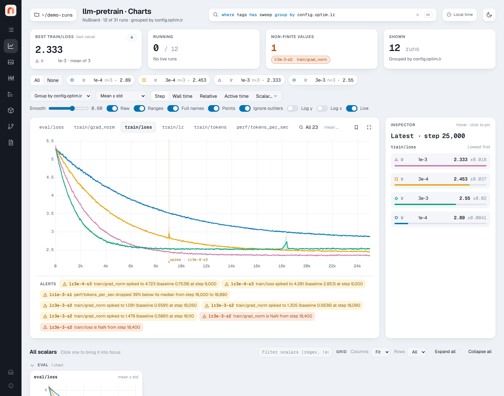

<p align="center"></p>

<h1 align="center">NuBoard</h1>

<p align="center"><b>Experiment tracking that lives in a folder.</b><br>
Log from Python with three calls. Every run is a folder. View thousands of runs in your browser.</p>



```python
import nuboard as nb

with nb.init("my-project", run_name="baseline", config={"lr": 3e-4}) as run:
    for step in range(10_000):
        loss = train_step()
        run.add_scalar({"train/loss": loss}, step=step)  # a few µs, never blocks training
```

```bash
nuboard up experiments        # http://localhost:6070
```

## Why

- **No setup.** No account, no server, no database. `pip install nuboard` gives
  you logging and the viewer; logging uses only the standard library, so it
  adds nothing to the import time of a training script.
- **Folder-contained.** Each run is one folder (`run.json`, an append-only
  binary log, a media pack, a Parquet file at the end). Copy it, rsync it, zip
  it, delete it. Notes, tags, saved views and hypothesis boards live in the
  project folder too, so they can be committed to git.
- **Fast.** Logging is an in-memory append; a background thread writes
  columnar frames. The viewer reads a million points in about a tenth of a
  second and lists thousands of runs instantly (see the
  [benchmarks](https://eagomez2.github.io/nuboard/benchmarks/)).
- **Records what you forget.** Config, git commit and uncommitted diff,
  installed packages, GPUs, command line, rank, console output and CPU, memory
  and GPU use, automatically.
- **Crash-safe.** A killed process loses at most the last second of data; torn
  writes are ignored; crashes are marked with their traceback.

## Quick start

```bash
pip install nuboard                   # or: uv pip install nuboard
nuboard demo demo-runs --up --open    # a demo workspace with a live run
```

Then try `where tags has "sweep" group by config.optim.lr` in the query bar and
open the Charts page. The [quickstart](https://eagomez2.github.io/nuboard/quickstart/) has a tour, and
[installation](https://eagomez2.github.io/nuboard/installation/) covers building from source.

## Features

| Area | What you get |
| --- | --- |
| Python API | `init` (with resume, fork, ranks and extra jobs such as an evaluator), `add_scalar` and `add_*` for text, images, audio, video, figures (Plotly, Vega-Lite, Bokeh, matplotlib, waveforms), histograms, PR curves, tables, point clouds, HTML and files; versioned artifacts with `add_artifact` and `use_artifact`; timers (`run.timer`) for epochs, validation and callbacks; system metrics and console capture. See the [Python API](https://eagomez2.github.io/nuboard/api/) |
| Storage | a documented [file format](https://eagomez2.github.io/nuboard/reference/format/), Parquet compaction with zoom levels, versioned artifacts |
| Analysis | `nb.load("project").scalars("loss", group_by="config.lr")` returns Arrow tables |
| Runs | a query language, stars, notes, tags, typed properties, collections, saved views, run details and config and file diffs |
| Charts | grouped lines with bands, smoothing, zoom that loads finer data, a linked crosshair, live updates, any scalar as the x axis |
| Timing | where a run's time went: each timer's calls, mean, p95, total and share, its duration per step, findings such as spikes and slow ranks, and a timeline of one step with a lane per rank |
| Media | every logged kind with a step slider, side-by-side comparison across runs and steps, and interactive figures |
| Hypotheses | boards that track what each run was testing and which result led to the next idea |
| Reports | Markdown reports with logged items, live charts and snapshots; export as HTML or a zip |
| Sweeps, Timeline, Artifacts | parallel coordinates and per-parameter scatters, runs over wall-clock time, artifact versions and lineage |
| Health alerts | NaN/Inf, loss and gradient spikes, throughput drops, per scalar and rank |
| CLI | `nuboard up`, `demo`, `ls`, `rm`, `compact`, `merge`, `artifact`, `import-tensorboard`; see the [command line reference](https://eagomez2.github.io/nuboard/reference/cli/) |

What changed in each release is in the [changelog](https://eagomez2.github.io/nuboard/changelog/), and the
[known limitations](https://eagomez2.github.io/nuboard/reference/limitations/) page lists what doesn't work yet.

## Documentation

The docs are a [MkDocs](https://www.mkdocs.org/) site in `docs/`:

```bash
uv run mkdocs serve    # http://localhost:8000
```

- [Installation](https://eagomez2.github.io/nuboard/installation/) and [Quickstart](https://eagomez2.github.io/nuboard/quickstart/)
- [Logging from Python](https://eagomez2.github.io/nuboard/guide/logging/), [Using the viewer](https://eagomez2.github.io/nuboard/guide/viewer/),
  [Sweeps](https://eagomez2.github.io/nuboard/guide/sweeps/), [Health alerts](https://eagomez2.github.io/nuboard/guide/alerts/),
  [Artifacts and lineage](https://eagomez2.github.io/nuboard/guide/artifacts/), [Analysis API](https://eagomez2.github.io/nuboard/guide/analysis/),
  [Reports](https://eagomez2.github.io/nuboard/guide/reports/), [Hypotheses](https://eagomez2.github.io/nuboard/guide/hypotheses/),
  [Reproducibility](https://eagomez2.github.io/nuboard/guide/reproducibility/),
  [Distributed training](https://eagomez2.github.io/nuboard/guide/distributed/),
  [Evaluating while training](https://eagomez2.github.io/nuboard/guide/jobs/),
  [Working on several machines](https://eagomez2.github.io/nuboard/guide/machines/),
  [Importing from TensorBoard](https://eagomez2.github.io/nuboard/guide/tensorboard/)
- [Python API](https://eagomez2.github.io/nuboard/api/), one page per call
- Reference: [command line](https://eagomez2.github.io/nuboard/reference/cli/), [query language](https://eagomez2.github.io/nuboard/reference/query/), [file format](https://eagomez2.github.io/nuboard/reference/format/),
  [architecture](https://eagomez2.github.io/nuboard/reference/architecture/), [benchmarks](https://eagomez2.github.io/nuboard/benchmarks/), [development](https://eagomez2.github.io/nuboard/reference/development/)

## Development

```bash
uv sync                                              # Python + dev tools
(cd frontend && pnpm install && pnpm build)          # builds the viewer into src/nuboard/static/
uv run pytest && uv run ruff check . && uv run pyright
(cd frontend && pnpm test && pnpm check && pnpm lint && pnpm e2e)
uv build                                             # wheel with the frontend bundled
```

See [Development](https://eagomez2.github.io/nuboard/reference/development/) for the repository layout, the rules for
the logging side, and how to rename the project (the name lives in three
places).

## License

NuBoard is released under the [MIT License](https://github.com/eagomez2/nuboard/blob/main/LICENSE).

## Requirements

Python 3.10+ on Linux, macOS or Windows. It installs NumPy, PyArrow, Starlette and
uvicorn for the viewer; logging uses only the standard library. Building the
frontend from source needs Node 20+ and pnpm (`brew install pnpm` on macOS);
installing from PyPI does not.
