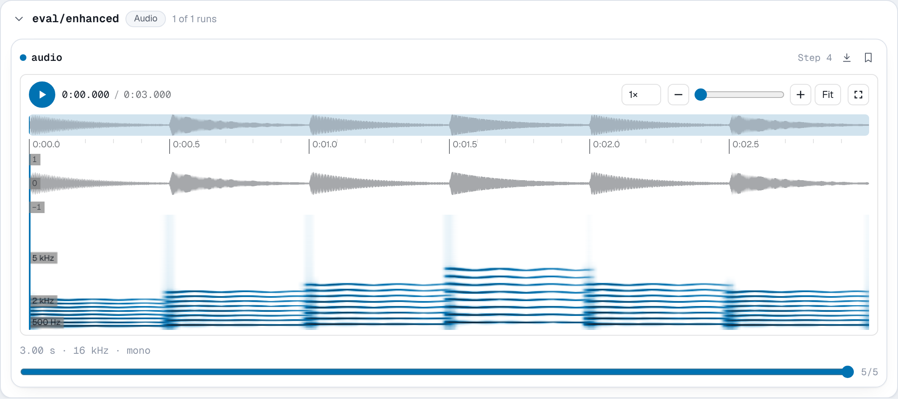

# `add_audio`

```python
run.add_audio(key, audio, step=None, *, sample_rate=None, caption=None, time=None)
```

Logs a sound clip, such as a model's output for a speech or music task.

**Parameters**

- **key** (*str*): the name the audio is logged under.
- **audio**: one of
    - a NumPy array or tensor of shape `(samples,)` (mono) or
      `(channels, samples)`, up to 16 channels;
    - the path of a WAV, FLAC, MP3, Ogg/Opus, M4A, AAC or WebM file;
    - the bytes of such a file.
- **step** (*int*, optional): the training step.
- **sample_rate** (*int*): samples per second. Required for arrays and
  ignored for files and bytes, which carry their own.
- **caption** (*str*, optional): a caption shown with the player.

**Shape and dtype.** The shorter axis of a 2-D array is taken as the channel
axis, so `(samples, channels)` works too. Floats are read as -1 to 1 and
clipped, and NaN becomes silence. `int16` samples are stored as they are, and
`int32` samples are scaled down to 16 bits.

**Stored as** 16-bit PCM WAV for arrays, written with the standard library's
`wave` module. That is 32 KB per second of 16 kHz mono. Files and bytes are
stored as they are, so log a FLAC or Opus file when size matters. The sample
rate, channel count and duration are recorded with each WAV clip.

**In the viewer** each card has a player. The default waveform player shows a
waveform and a spectrogram, zooms, loops a region, and keeps time-stamped
notes. A simple player is one click away. See
[Audio](../guide/viewer.md#audio) for both. Audio is listed under **Audio**.

**Example**

```python
import numpy as np

import nuboard as nb

run = nb.init("api-tour", run_name="audio")
rate = 16_000
t = np.arange(3 * rate) / rate

# A plucked arpeggio: six notes of half a second, each with 8 harmonics and vibrato
notes = np.repeat([262, 330, 392, 523, 392, 330], rate // 2)
f0 = notes * (1 + 0.015 * np.sin(2 * np.pi * 5.5 * t))
phase = 2 * np.pi * np.cumsum(f0) / rate
pluck = np.minimum(1, (t % 0.5) / 0.01) * np.exp(-5 * (t % 0.5))
clean = 0.25 * pluck * sum(np.sin(k * phase) / k for k in range(1, 9))
rng = np.random.default_rng(0)

for epoch in range(5):
    residual = 0.3 * (1 - epoch / 4) * rng.normal(size=t.size)
    run.add_audio("eval/enhanced", clean + residual, step=epoch, sample_rate=rate)

run.add_audio("eval/clean", clean, step=0, sample_rate=rate, caption="target")
run.finish()
```

**Expected result**


