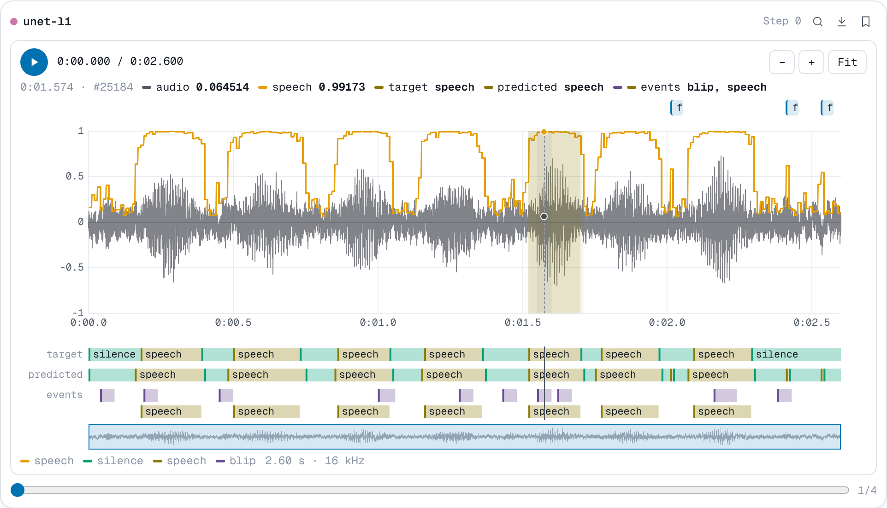

# `add_figure`

```python
run.add_figure(key, figure, step=None, *, time=None)
```

Logs a chart made with a plotting library: a confusion matrix, a per-class
bar chart, a learning-rate schedule, or anything else a line chart does not
cover.

**Parameters**

- **key** (*str*): the name the figure is logged under.
- **figure**: one of
    - a matplotlib figure, or the `matplotlib.pyplot` module for the current
      figure;
    - a Plotly figure, or a Plotly figure dict (`{"data": [...], "layout": {...}}`);
    - an Altair chart, or a Vega-Lite spec as a dict with a `$schema`;
    - a Bokeh figure or layout;
    - a [`nb.WaveformFigure`](#waveforms-with-signals): audio with signals
      drawn over its waveform.
- **step** (*int*, optional): the training step.

**Stored as** the figure's own serialized form: Plotly JSON, a Vega-Lite spec
or a Bokeh JSON item, and SVG for matplotlib. The figure is serialized on the
calling thread, since figures are mutable, with the library that made it.
NuBoard depends on none of these libraries, and plain dicts work without any
of them.

**In the viewer** Plotly, Vega-Lite and Bokeh figures stay interactive (hover,
zoom, pan), each in its own sandboxed frame, and follow the light or dark
theme. Plotly and Vega-Lite are bundled with the viewer, so they work offline.
Bokeh loads BokehJS from its CDN, for the exact version that wrote the figure.
Matplotlib figures show as images. Figures are listed under **Figures**.

**Example**

```python
import matplotlib

matplotlib.use("Agg")
import matplotlib.pyplot as plt
import numpy as np

import nuboard as nb

classes = ["cat", "dog", "bird", "fish"]
run = nb.init("api-tour", name="figures")
rng = np.random.default_rng(0)

for epoch in range(3):
    acc = 0.55 + 0.12 * epoch
    cm = rng.integers(1, 8, (4, 4)) + np.diag(rng.integers(30, 40, 4)) * (1 + epoch)

    fig, ax = plt.subplots(figsize=(4, 3.4))
    ax.imshow(cm, cmap="Blues")
    ax.set(xticks=range(4), yticks=range(4), xticklabels=classes, yticklabels=classes)
    ax.set(xlabel="predicted", ylabel="true", title=f"epoch {epoch}")
    for i, j in np.ndindex(cm.shape):
        ax.text(j, i, cm[i, j], ha="center", va="center", fontsize=8)
    run.add_figure("eval/confusion", fig, step=epoch)
    plt.close(fig)

    per_class = [{"class": c, "acc": round(acc + rng.normal(0, 0.06), 3)} for c in classes]
    run.add_figure(
        "eval/per_class",
        {
            "$schema": "https://vega.github.io/schema/vega-lite/v6.json",
            "data": {"values": per_class},
            "width": 320,
            "height": 260,
            "mark": "bar",
            "encoding": {
                "x": {"field": "class", "type": "nominal"},
                "y": {"field": "acc", "type": "quantitative", "scale": {"domain": [0, 1]}},
            },
        },
        step=epoch,
    )

run.finish()
```

The same chart from each library:

=== "Plotly"

    ```python
    import plotly.express as px

    fig = px.bar(x=classes, y=accs, labels={"x": "class", "y": "acc"})
    run.add_figure("eval/per_class", fig, step=epoch)
    ```

=== "Altair"

    ```python
    import altair as alt
    import pandas as pd

    chart = (
        alt.Chart(pd.DataFrame({"class": classes, "acc": accs})).mark_bar().encode(x="class", y="acc")
    )
    run.add_figure("eval/per_class", chart, step=epoch)
    ```

=== "Bokeh"

    ```python
    from bokeh.plotting import figure

    fig = figure(x_range=classes, height=300)
    fig.vbar(x=classes, top=accs, width=0.8)
    run.add_figure("eval/per_class", fig, step=epoch)
    ```

=== "matplotlib"

    ```python
    fig, ax = plt.subplots()
    ax.bar(classes, accs)
    run.add_figure("eval/per_class", fig, step=epoch)
    ```

**Expected result**


## Waveforms with signals

```python
nb.WaveformFigure(audio, sample_rate, signals, *, range=None, caption=None)
```

A figure made by NuBoard itself: a waveform with signals drawn over it, such
as a voice activity probability, a gain mask or an envelope, one value per
audio sample. It needs no plotting library, only NumPy for the arrays.

**Parameters**

- **audio**: a `(samples,)` or `(channels, samples)` array or tensor, read as
  [`add_audio`](add_audio.md) reads it.
- **sample_rate** (*int*): samples per second.
- **signals**: an array or tensor of one value per audio sample, or a dict of
  them by name. A signal of the wrong length raises `ValueError` when it is
  logged. NaN leaves a gap.
- **range** (*tuple*, optional): the values at the bottom and top of the plot.
  Defaults to the waveform's own axis, -1 to 1 (full scale), so a signal
  shares the waveform's scale: an envelope traces it and a probability of 1
  reaches the top. With a range, the signals get their own axis on the right.
- **caption** (*str*, optional): a caption shown under the plot.

A model that outputs one value per frame repeats it over the frame's samples:

```python
probs = vad(wav)  # one speech probability per 10 ms frame at 16 kHz
signal = np.repeat(probs, 160)[: len(wav)]
run.add_figure("eval/vad", nb.WaveformFigure(wav, 16_000, {"vad": signal}), step=epoch)
```

**Stored as** the audio as 16-bit WAV followed by each signal as float32,
written on the background thread. A signal therefore takes twice the space
of mono audio: an hour at 16 kHz is 115 MB of audio and 230 MB per signal.

**In the viewer** the figure is listed under **Figures** and drawn as an
interactive plot, not in the audio player:

- **Accurate at every zoom.** Each pixel column draws the first, smallest,
  largest and last sample under it (M4 decimation), recomputed as you zoom.
  This draws the same pixels as a line through every sample, so peaks and
  their signs are never lost, down to single samples, where the points show.
- **Fast on long files.** The minimum and maximum of blocks of samples are
  computed once when the figure loads, so a redraw costs the same for a clip
  as for an hour. A 10-minute file shows in about 2 s and an hour in about 10 s
  (mostly fetching it); zooming and scrolling stay smooth after that.
- **Exact values.** Hovering shows the time, the sample index and the value
  of the audio and of each signal at that sample, with a dot on each curve.
- **Zoom and scroll.** Drag across the plot to zoom in, Ctrl/⌘ + wheel zooms
  around the pointer, Shift + wheel (or a sideways swipe) scrolls, and
  double-click or **Fit** shows the whole file. The overview under the plot
  shows where the view is; drag on it to move there.
- **Playback.** The play button plays the audio and the playhead follows it.
  Click the plot to start from there.

In a report, the figure embeds like any logged item. An HTML export keeps it
interactive, with the same plot and the clip's audio, offline; a .zip export
writes its audio as a `.wav` and its signals as a CSV.

The plot does not have a spectrogram or notes. For those, also log the clip
with [`add_audio`](add_audio.md), which opens in the waveform and
spectrogram player.

`nuboard demo` logs one per model in the `speech-denoise` project, under
`vad/enhanced`: the enhanced output with a speech probability, rough at
epoch 0 and sharp by epoch 30.

**Expected result**


