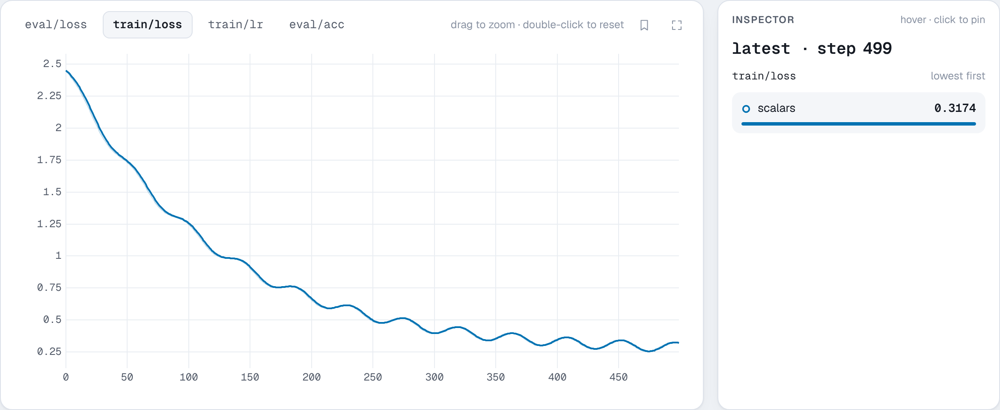

# `add_scalar`

```python
run.add_scalar(key, value=None, step=None, *, time=None, all_ranks=None)
```

Logs a scalar, such as a loss, an accuracy or a learning rate, or several
scalars at the same step. It covers TensorBoard's `add_scalar` and
`add_scalars` in one method:

```python
run.add_scalar("train/loss", 0.42, step=10)  # one
run.add_scalar({"train/loss": 0.42, "train/lr": 3e-4}, step=10)  # several
```

`run.log(data, step=None)` is the same as `run.add_scalar(data, step=step)`
and keeps working.

**Parameters**

- **key** (*str or dict*): the scalar's name, such as `"train/loss"`. To log
  several at once, a dict of names and values. Nested dicts are flattened with
  `/`, so `{"train": {"loss": 0.4}}` logs `train/loss`.
- **value**: the value, when `key` is a name. It can be a Python number or
  bool, a NumPy scalar or a 0-d tensor. Values are converted to float on the
  background thread, so passing a CUDA tensor does not sync on the calling
  thread. Strings are skipped with a one-time warning; use
  [`add_text`](add_text.md) for those.
- **step** (*int*, optional): the training step. Defaults to one more than
  the previous call's step. Pass it explicitly when you log several times per
  step, such as train and eval scalars.
- **time** (*float*, optional): a Unix timestamp. Defaults to now.
- **all_ranks** (*bool*, optional): log from this rank even if it is not rank
  0, overriding `nb.init`'s setting for this call.

**Raises** `TypeError` when `key` is a name and `value` is missing.

**Stored as** one columnar frame per flush in the event log: a step, a time
and a float64 per scalar. Logging a dict of 50 scalars costs a few
microseconds, and each value takes about 8 bytes on disk.

**In the viewer** each key is a line chart on the **Charts** page, with one
line per run, grouped in sections by the key's prefix. Runs can be grouped
into a mean and spread band, smoothed, and plotted against wall time or
another scalar. NaN and infinite values are stored as they are and flagged on
the chart and by the [health alerts](../guide/alerts.md). The Runs table shows
each run's best or last value of a scalar you pick, and queries can filter on
it (`train/loss.min < 0.3`).

**Example**

```python
import math

import nuboard as nb

run = nb.init("api-tour", name="scalars")

for step in range(500):
    lr = 1e-3 * min(1, step / 50) * 0.5 * (1 + math.cos(math.pi * step / 500))
    loss = 2.2 * math.exp(-step / 120) + 0.25 + 0.04 * math.sin(step / 7)
    run.add_scalar({"train": {"loss": loss, "lr": lr}}, step=step)

    if step % 50 == 0:
        run.add_scalar("eval/loss", loss + 0.08, step=step)
        run.add_scalar("eval/acc", 1 - loss / 3, step=step)

run.finish()
```

**Expected result**


