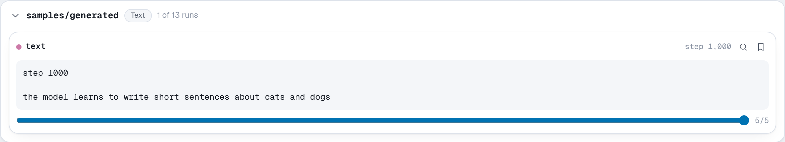

# `add_text`

```python
run.add_text(key, text, step=None, *, time=None, all_ranks=False)
```

Logs a string, such as a generated sample, a decoded transcript or a note
about the run.

**Parameters**

- **key** (*str*): the name the text is logged under.
- **text** (*str*): the text. Other values are converted with `str`.
- **step** (*int*, optional): the training step.
- **all_ranks** (*bool*): log from every rank, not only rank 0.

**Stored as** UTF-8 in the event log, not the media pack, so text costs about
its length on disk.

**In the viewer** text shows as preformatted text, so line breaks and
alignment are kept. Text keys are listed under **Text** on the Media page.

**Example**

```python
import random

import nuboard as nb

run = nb.init("api-tour", name="text")
words = "the model learns to write short sentences about cats and dogs".split()
random.seed(0)

for step in range(0, 1001, 250):
    keep = min(1.0, 0.25 + step / 1000)
    sample = " ".join(w if random.random() < keep else "<unk>" for w in words)
    run.add_scalar({"train/loss": 3 - 2 * keep}, step=step)
    run.add_text("samples/generated", f"step {step}\n\n{sample}", step=step)

run.finish()
```

**Expected result**


