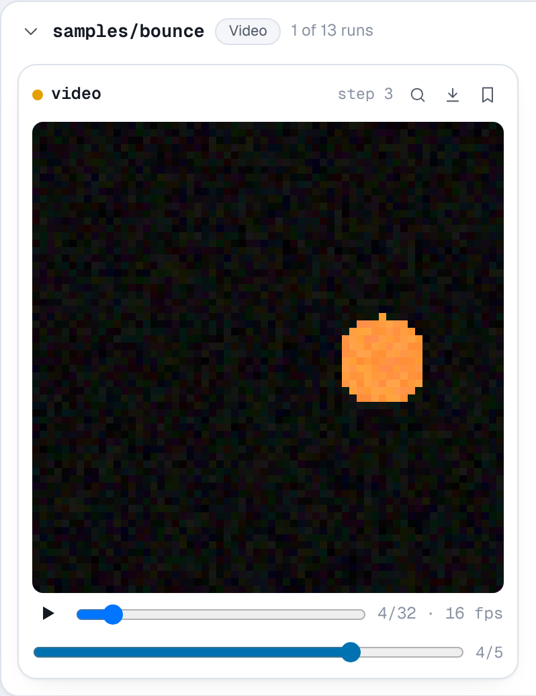

# `add_video`

```python
run.add_video(key, video, step=None, *, fps=4, caption=None, time=None)
```

Logs a short clip, such as a reinforcement learning rollout, a video model's
samples or an animation of how a prediction changes over an episode. It
matches TensorBoard's `add_video`, including its `(N, T, C, H, W)` batches.

**Parameters**

- **key** (*str*): the name the video is logged under.
- **video**: one of
    - a NumPy array or tensor of frames, shaped `(T, H, W, C)`,
      `(T, C, H, W)`, `(T, H, W)` for grayscale, or `(N, T, C, H, W)` for a
      batch of N clips, which are tiled into one grid;
    - the path of an MP4, WebM, MOV, Ogg, GIF or animated PNG file;
    - the bytes of such a file.
- **step** (*int*, optional): the training step.
- **fps** (*float*): frames per second, for arrays. Defaults to 4, as in
  TensorBoard. Files and bytes carry their own frame rate.
- **caption** (*str*, optional): a caption shown under the player.

**Shape and dtype.** C is 1 (grayscale), 3 (RGB) or 4 (RGBA). A 4-D array is
read as `(T, C, H, W)` when its second axis has 1, 3 or 4 entries and its last
axis does not, as PyTorch tensors usually are, and as `(T, H, W, C)`
otherwise. Floats are read as 0 to 1 and clipped, and NaN becomes 0. `uint8`
frames are stored as they are. A batch of N clips is tiled into a grid of
`ceil(sqrt(N))` columns, as TensorBoard does.

**Stored as** an animated PNG for arrays, written with the standard library's
`zlib` and NumPy, so it needs no ffmpeg or moviepy. It is lossless, and loops.
Because it is lossless, it suits the small frames of games, simulations and
samples (an 84 by 84 clip of 48 frames is about 10 KB); for long or
camera-sized footage, encode an MP4 or WebM yourself and log the file. Files
and bytes are stored as they are. The frame rate, frame count, size and
duration are recorded with each clip from an array.

**In the viewer** each card has a player with play and pause, a frame slider
and the frame rate. MP4, WebM, MOV and Ogg files play in the browser's own
video player. Videos are listed under **Video** on the Media page, and the
step slider shows how the clip changed over training.

**Example**

```python
import numpy as np

import nuboard as nb

run = nb.init("api-tour", name="video")
rng = np.random.default_rng(0)
frames, size = 32, 64
yy, xx = np.mgrid[:size, :size]

for epoch in range(5):
    clip = np.zeros((frames, size, size, 3), dtype="float32")
    noise = 0.4 * (1 - epoch / 4)

    for t in range(frames):  # a ball bouncing across the frame
        cx = 8 + (size - 16) * abs((t / (frames / 2)) % 2 - 1)
        cy = size - 12 - 36 * abs(np.sin(np.pi * t / (frames / 2)))
        ball = ((xx - cx) ** 2 + (yy - cy) ** 2 < 36).astype("float32")
        clip[t] = ball[..., None] * (1.0, 0.55, 0.2)

    clip += noise * rng.random(clip.shape)
    run.add_video("samples/bounce", clip, step=epoch, fps=16)

run.finish()
```

**Expected result**


