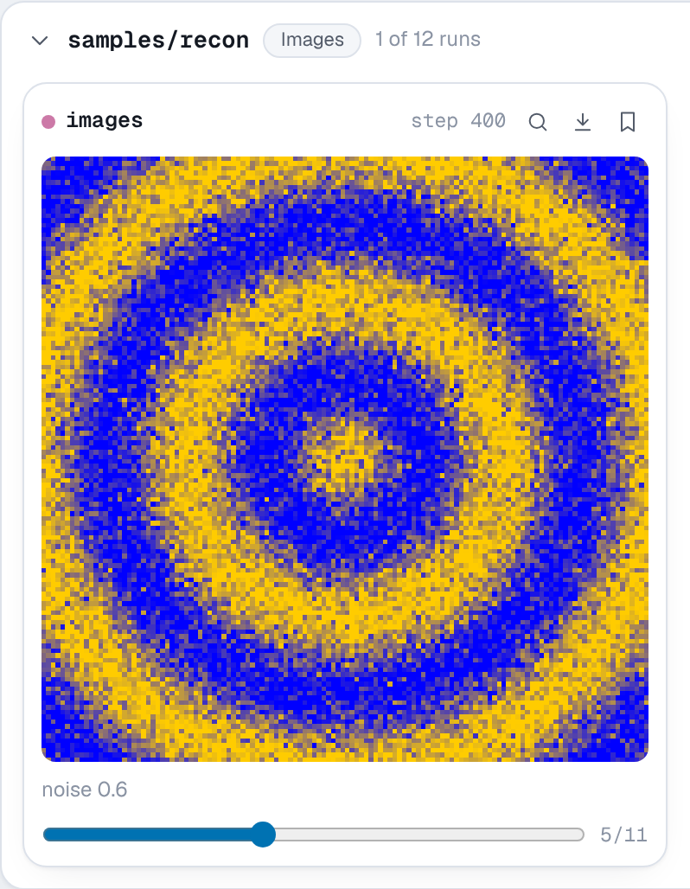
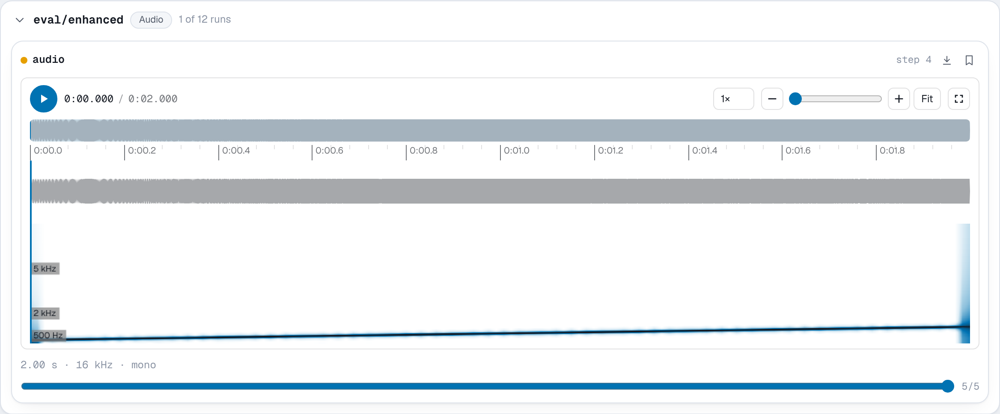
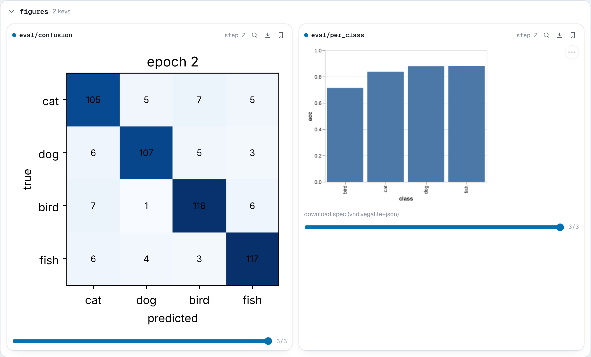
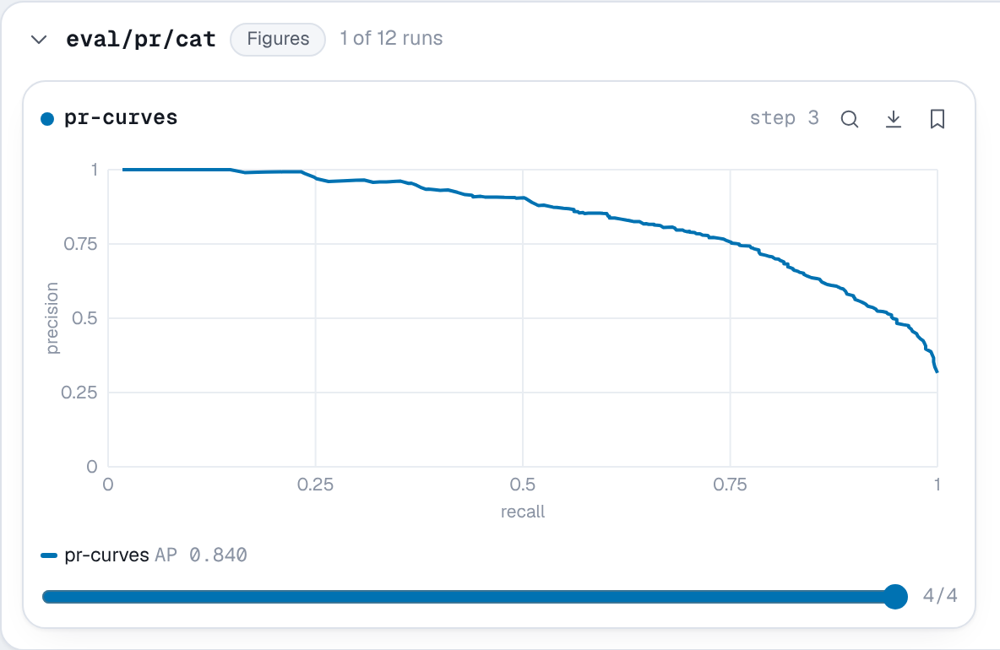
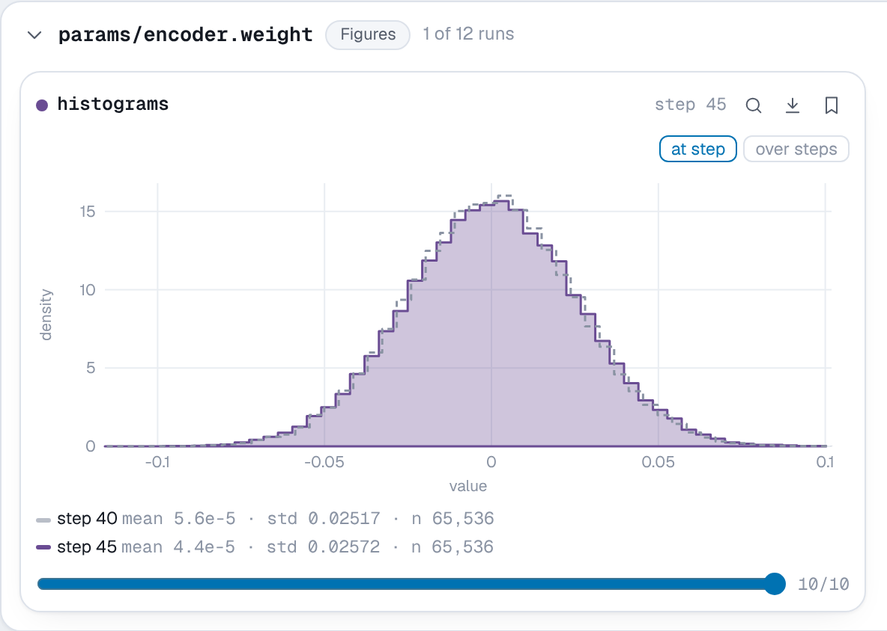
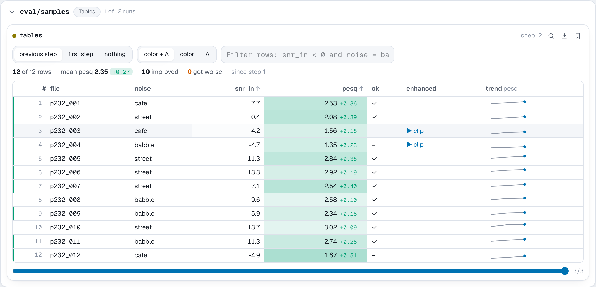
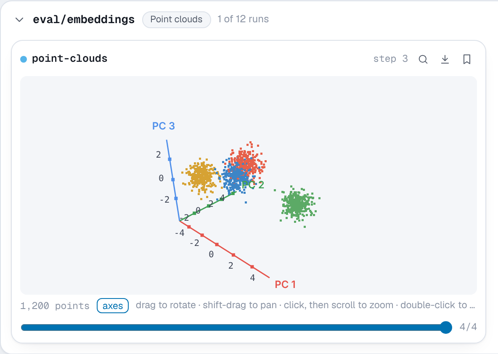
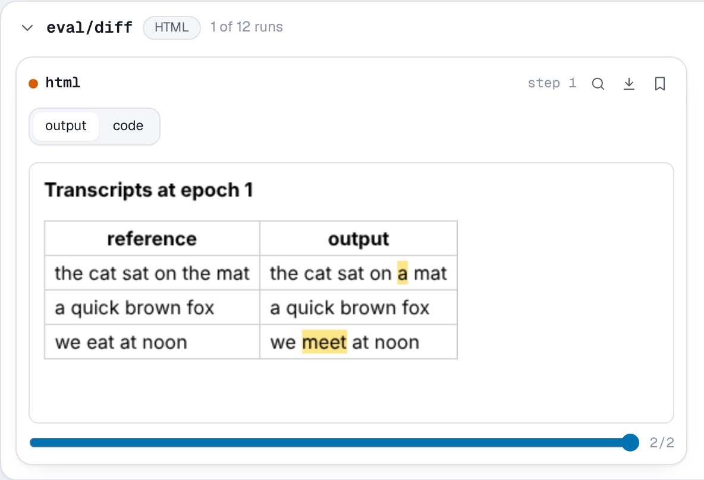

# Media

Besides numbers, a run can log text, images, audio, figures, PR curves,
distributions, tables, point clouds and HTML. Each `add_*` method logs one item
under a key at a step. The viewer's **Media** page shows them with a card per
run and key, and a step slider on each card, so you can scroll through how a
sample changed over training.

All of these methods share the [conventions](index.md#conventions) for keys,
steps, `time=`, tensors and ranks. In short:

- `step` defaults to the step of the latest `run.log` call.
- Arrays are copied, and tensors detached and moved to the CPU, before the call
  returns. Encoding happens on the background thread.
- Only rank 0 logs media.
- The bytes go to the run's `media.r0.pack`, indexed by frames in its event
  log, as described in the [file format](../reference/format.md#media-pack-mediarrankpack).

The examples on this page are complete scripts. Each one writes a run to the
`api-tour` project, which you can open with `nuboard up experiments`. The
pictures under **Expected result** were taken from those runs.

## `add_text`

```python
run.add_text(key, text, step=None, *, time=None, all_ranks=False)
```

Logs a string, such as a generated sample, a decoded transcript or a note
about the run.

**Parameters**

- **key** (*str*): the name the text is logged under.
- **text** (*str*): the text. Other values are converted with `str`.
- **step** (*int*, optional): the training step.
- **all_ranks** (*bool*): log from every rank, not only rank 0.

**Stored as** UTF-8 in the event log, not the media pack, so text costs about
its length on disk.

**In the viewer** text shows as preformatted text, so line breaks and
alignment are kept. Text keys are listed under **Text** on the Media page.

**Example**

```python
import random

import nuboard as nb

run = nb.init("api-tour", name="text")
words = "the model learns to write short sentences about cats and dogs".split()
random.seed(0)

for step in range(0, 1001, 250):
    keep = min(1.0, 0.25 + step / 1000)
    sample = " ".join(w if random.random() < keep else "<unk>" for w in words)
    run.log({"train/loss": 3 - 2 * keep}, step=step)
    run.add_text("samples/generated", f"step {step}\n\n{sample}", step=step)

run.finish()
```

**Expected result**


## `add_image`

```python
run.add_image(key, image, step=None, *, caption=None, time=None)
```

Logs an image, such as an input batch, a reconstruction or an attention map.

**Parameters**

- **key** (*str*): the name the image is logged under.
- **image**: one of
    - a NumPy array or tensor of shape `(H, W)` (grayscale), `(H, W, C)` or
      `(C, H, W)`, with `C` being 1 (gray), 3 (RGB) or 4 (RGBA);
    - a PIL image;
    - PNG, JPEG, GIF, WebP or SVG bytes;
    - the path of an image file.
- **step** (*int*, optional): the training step.
- **caption** (*str*, optional): a caption shown under the image.

**Shape and dtype.** A 3-D array whose first axis is 1, 3 or 4 and whose last
axis is not is read as `(C, H, W)`, the PyTorch layout. Otherwise it is read as
`(H, W, C)`. This matches TensorBoard's `dataformats="CHW"` and `"HWC"` without
having to pass it. The values are read by dtype:

| dtype | Range | Stored |
| --- | --- | --- |
| `uint8` | 0 to 255 | as is |
| floats | 0 to 1, clipped | scaled to 0 to 255 |
| other integers | 0 to 255, clipped | as is |

To log a batch as one picture, tile it first, for example with
`torchvision.utils.make_grid(batch)`, which returns a `(3, H, W)` tensor.

**Stored as** a PNG for arrays and PIL images. The PNG is encoded with the
standard library's `zlib`, so neither PIL nor NumPy is needed for encoding.
Bytes and files are stored as they are, so a JPEG stays a JPEG.

**In the viewer** each card shows the image at its step, with a slider over
the steps it was logged at. Clicking it opens it large. Images are listed
under **Images**.

**Example**

```python
import numpy as np

import nuboard as nb

run = nb.init("api-tour", name="images")
y, x = np.mgrid[-1:1:128j, -1:1:128j]
target = 0.5 + 0.5 * np.cos(12 * np.hypot(x, y))  # rings, floats in [0, 1]
rng = np.random.default_rng(0)

for step in range(0, 1001, 100):
    noise = 1 - step / 1000
    recon = np.clip(target + noise * rng.normal(0, 0.4, target.shape), 0, 1)
    rgb = np.stack([recon, recon * 0.8, 1 - recon])  # (3, H, W), as PyTorch lays it out
    run.log({"train/mse": float(((recon - target) ** 2).mean())}, step=step)
    run.add_image("samples/recon", rgb, step=step, caption=f"noise {noise:.1f}")

run.add_image("samples/target", (target * 255).astype(np.uint8), step=0)  # (H, W) gray
run.finish()
```

**Expected result**



## `add_audio`

```python
run.add_audio(key, audio, step=None, *, sample_rate=None, caption=None, time=None)
```

Logs a sound clip, such as a model's output for a speech or music task.

**Parameters**

- **key** (*str*): the name the audio is logged under.
- **audio**: one of
    - a NumPy array or tensor of shape `(samples,)` (mono) or
      `(channels, samples)`, up to 16 channels;
    - the path of a WAV, FLAC, MP3, Ogg/Opus, M4A, AAC or WebM file;
    - the bytes of such a file.
- **step** (*int*, optional): the training step.
- **sample_rate** (*int*): samples per second. Required for arrays and
  ignored for files and bytes, which carry their own.
- **caption** (*str*, optional): a caption shown with the player.

**Shape and dtype.** The shorter axis of a 2-D array is taken as the channel
axis, so `(samples, channels)` works too. Floats are read as -1 to 1 and
clipped, and NaN becomes silence. `int16` samples are stored as they are, and
`int32` samples are scaled down to 16 bits.

**Stored as** 16-bit PCM WAV for arrays, written with the standard library's
`wave` module. That is 32 KB per second of 16 kHz mono. Files and bytes are
stored as they are, so log a FLAC or Opus file when size matters. The sample
rate, channel count and duration are recorded with each WAV clip.

**In the viewer** each card has a player. The default waveform player shows a
waveform and a spectrogram, zooms, loops a region, and keeps time-stamped
notes. A simple player is one click away. See
[Audio](../guide/viewer.md#audio) for both. Audio is listed under **Audio**.

**Example**

```python
import numpy as np

import nuboard as nb

run = nb.init("api-tour", name="audio")
rate = 16_000
t = np.arange(2 * rate) / rate
clean = 0.4 * np.sin(2 * np.pi * (220 + 220 * t) * t)  # a rising chirp
rng = np.random.default_rng(0)

for epoch in range(5):
    residual = 0.3 * (1 - epoch / 4) * rng.normal(size=t.size)
    run.add_audio("eval/enhanced", clean + residual, step=epoch, sample_rate=rate)

run.add_audio("eval/clean", clean, step=0, sample_rate=rate, caption="target")
run.finish()
```

**Expected result**



## `add_figure`

```python
run.add_figure(key, figure, step=None, *, time=None)
```

Logs a chart made with a plotting library: a confusion matrix, a per-class
bar chart, a learning-rate schedule, or anything else a line chart does not
cover.

**Parameters**

- **key** (*str*): the name the figure is logged under.
- **figure**: one of
    - a matplotlib figure, or the `matplotlib.pyplot` module for the current
      figure;
    - a Plotly figure, or a Plotly figure dict (`{"data": [...], "layout": {...}}`);
    - an Altair chart, or a Vega-Lite spec as a dict with a `$schema`;
    - a Bokeh figure or layout.
- **step** (*int*, optional): the training step.

**Stored as** the figure's own serialized form: Plotly JSON, a Vega-Lite spec
or a Bokeh JSON item, and SVG for matplotlib. The figure is serialized on the
calling thread, since figures are mutable, with the library that made it.
NuBoard depends on none of these libraries, and plain dicts work without any
of them.

**In the viewer** Plotly, Vega-Lite and Bokeh figures stay interactive (hover,
zoom, pan), each in its own sandboxed frame, and follow the light or dark
theme. Plotly and Vega-Lite are bundled with the viewer, so they work offline.
Bokeh loads BokehJS from its CDN, for the exact version that wrote the figure.
Matplotlib figures show as images. Figures are listed under **Figures**.

**Example**

```python
import matplotlib

matplotlib.use("Agg")
import matplotlib.pyplot as plt
import numpy as np

import nuboard as nb

classes = ["cat", "dog", "bird", "fish"]
run = nb.init("api-tour", name="figures")
rng = np.random.default_rng(0)

for epoch in range(3):
    acc = 0.55 + 0.12 * epoch
    cm = rng.integers(1, 8, (4, 4)) + np.diag(rng.integers(30, 40, 4)) * (1 + epoch)

    fig, ax = plt.subplots(figsize=(4, 3.4))
    ax.imshow(cm, cmap="Blues")
    ax.set(xticks=range(4), yticks=range(4), xticklabels=classes, yticklabels=classes)
    ax.set(xlabel="predicted", ylabel="true", title=f"epoch {epoch}")
    for i, j in np.ndindex(cm.shape):
        ax.text(j, i, cm[i, j], ha="center", va="center", fontsize=8)
    run.add_figure("eval/confusion", fig, step=epoch)
    plt.close(fig)

    per_class = [{"class": c, "acc": round(acc + rng.normal(0, 0.06), 3)} for c in classes]
    run.add_figure(
        "eval/per_class",
        {
            "$schema": "https://vega.github.io/schema/vega-lite/v6.json",
            "data": {"values": per_class},
            "width": 320,
            "height": 260,
            "mark": "bar",
            "encoding": {
                "x": {"field": "class", "type": "nominal"},
                "y": {"field": "acc", "type": "quantitative", "scale": {"domain": [0, 1]}},
            },
        },
        step=epoch,
    )

run.finish()
```

The same chart from each library:

=== "Plotly"

    ```python
    import plotly.express as px

    fig = px.bar(x=classes, y=accs, labels={"x": "class", "y": "acc"})
    run.add_figure("eval/per_class", fig, step=epoch)
    ```

=== "Altair"

    ```python
    import altair as alt
    import pandas as pd

    chart = (
        alt.Chart(pd.DataFrame({"class": classes, "acc": accs})).mark_bar().encode(x="class", y="acc")
    )
    run.add_figure("eval/per_class", chart, step=epoch)
    ```

=== "Bokeh"

    ```python
    from bokeh.plotting import figure

    fig = figure(x_range=classes, height=300)
    fig.vbar(x=classes, top=accs, width=0.8)
    run.add_figure("eval/per_class", fig, step=epoch)
    ```

=== "matplotlib"

    ```python
    fig, ax = plt.subplots()
    ax.bar(classes, accs)
    run.add_figure("eval/per_class", fig, step=epoch)
    ```

**Expected result**



## `add_pr_curve`

```python
run.add_pr_curve(key, labels, predictions, step=None, *, num_thresholds=201, weights=None, time=None)
```

Logs a precision-recall curve for a binary decision, as TensorBoard's
`add_pr_curve` does. For several classes, log one curve per class, one
against the rest.

**Parameters**

- **key** (*str*): the name the curve is logged under, such as `eval/pr/cat`.
- **labels**: the ground truth, as booleans or 0 and 1, in an array, tensor
  or list of any shape.
- **predictions**: one score in 0 to 1 per label, such as a softmax
  probability. Scores outside are clipped.
- **step** (*int*, optional): the training step.
- **num_thresholds** (*int*): how many evenly spaced thresholds, from 0 to 1
  inclusive, to count at.
- **weights** (optional): a weight per example. Defaults to 1.

**Stored as** the true positive, false positive, true negative and false
negative counts at each threshold, with the precision and recall they give.
A prediction counts as positive at threshold `t` when it is at least `t`. The
predictions themselves are not stored, so a curve over a million examples
takes the same few kilobytes as one over a hundred.

**In the viewer** PR curves are listed under **Figures**. Each card draws its
run's curve in the run's color with its average precision, and a chart above
the cards overlays every run's curve at the chosen step. Hovering a curve
shows the threshold, precision, recall and the four counts there.

**Example**

```python
import numpy as np

import nuboard as nb

classes = ["cat", "dog", "bird"]
run = nb.init("api-tour", name="pr-curves")
rng = np.random.default_rng(0)
labels = rng.integers(0, 3, 2000)

for epoch in range(4):
    logits = 1.5 * rng.normal(size=(2000, 3)) + (0.5 + 0.6 * epoch) * np.eye(3)[labels]
    probs = np.exp(logits) / np.exp(logits).sum(1, keepdims=True)

    for c, name in enumerate(classes):
        run.add_pr_curve(f"eval/pr/{name}", labels == c, probs[:, c], step=epoch)

run.finish()
```

**Expected result**



## `add_histogram`

```python
run.add_histogram(key, values, step=None, *, bins=50, range=None, weights=None, time=None)
```

Logs the distribution of some values, as TensorBoard's `add_histogram` does.
Use it to watch weights, gradients or activations drift, vanish or explode,
or for the spread of a per-example score.

**Parameters**

- **key** (*str*): the name the distribution is logged under.
- **values**: numbers of any shape, as an array, tensor or list. They are
  flattened.
- **step** (*int*, optional): the training step.
- **bins** (*int or list of float*): the number of equal-width bins, or
  their edges, which must increase.
- **range** (*(float, float)*, optional): the low and high ends of the bins.
  Values outside are counted as `outside` but not binned. Defaults to the
  values' minimum and maximum.
- **weights** (optional): a weight per value, of the same shape as `values`.

**Stored as** the bin edges and counts, with the count, minimum, maximum,
mean and standard deviation of the values. NaN and infinite values are counted
as `nonfinite` and left out of the bins and statistics. A layer with millions
of weights takes a few hundred bytes per step. Arrays and tensors are binned
with NumPy on the background thread. Lists are binned in pure Python.

**In the viewer** distributions are listed under **Figures**. Each card
draws the histogram at the chosen step, filled in the run's color, with the
step logged before it as a dashed outline. The y axis is density, so steps
and runs with different ranges or bin counts compare fairly. **over steps**
switches to TensorBoard's distributions view: the median as a line, and bands
holding 68%, 86% and all of the values at each step. A chart above the cards
overlays every run's histogram at the chosen step.

**Example**

```python
import numpy as np

import nuboard as nb

run = nb.init("api-tour", name="histograms")
rng = np.random.default_rng(0)
weights = rng.normal(0, 0.02, 65_536)

for epoch in range(0, 50, 5):
    grads = rng.standard_t(6, 65_536) * 0.01 / (1 + epoch / 10)
    weights = weights * 1.01 + rng.normal(0, 0.004, weights.size)
    run.add_histogram("params/encoder.weight", weights, step=epoch)
    run.add_histogram("grads/encoder.weight", grads, step=epoch, bins=80, range=(-0.05, 0.05))

run.finish()
```

With PyTorch, log every parameter and its gradient after the backward pass:

```python
for name, p in model.named_parameters():
    run.add_histogram(f"params/{name}", p, step=epoch)
    if p.grad is not None:
        run.add_histogram(f"grads/{name}", p.grad, step=epoch)
```

**Expected result**



## `add_table`

```python
run.add_table(key, rows, step=None, *, row_id=None, time=None)
```

Logs a table, such as one row per test example with its scores. Log the same
table at each evaluation and the viewer shows how each row changed.

**Parameters**

- **key** (*str*): the name the table is logged under.
- **rows**: one of
    - a list of dicts, one per row (keys missing from a row are empty cells);
    - a dict of column lists;
    - a pandas DataFrame.
- **step** (*int*, optional): the training step.
- **row_id** (*str*, optional): the column that identifies a row across
  steps, such as a file name. Defaults to the first column.

**Cells** can be numbers, booleans, strings or None. NumPy and tensor scalars
become numbers, NaN and infinities become empty cells, and anything else
becomes its `str`. A cell can also hold media:

- `nb.Audio(data, sample_rate=None, caption=None)` takes what
  [`add_audio`](#add_audio) takes.
- `nb.Image(data, caption=None)` takes what [`add_image`](#add_image) takes.

Each column gets a type from its cells: number, bool, text, audio or image.

**Stored as** JSON, about 50 bytes per row of numbers, written with the
standard library. Media cells are stored as their own audio and image items
at the same step, so attach media only to the rows worth looking at, such as
the worst few.

**In the viewer** tables take the section's full width and are listed under
**Tables**. Each number is compared with the same row at the previous step or
the first step, and tinted green when it got better and orange when it got
worse. A column whose name looks like a loss or error (`loss`, `error`, `wer`)
counts as better when lower. You can sort, filter rows with comparisons such
as `snr_in < 0 and noise = babble`, plot a column's trend per row over steps,
and click a row for its values at every step and its media. See
[Tables](../guide/viewer.md#tables).

**Example**

```python
import numpy as np

import nuboard as nb

run = nb.init("api-tour", name="tables")
rng = np.random.default_rng(0)
files = [f"p232_{i:03d}" for i in range(1, 13)]
snr_in = rng.uniform(-5, 15, len(files)).round(1)
noise = rng.choice(["babble", "cafe", "street"], len(files))
rate = 16_000
t = np.arange(rate) / rate

for epoch in range(3):
    pesq = (1.2 + 0.08 * snr_in + 0.35 * epoch + rng.normal(0, 0.1, len(files))).round(2)
    rows = [
        {"file": f, "noise": n, "snr_in": s, "pesq": p, "ok": bool(p > 2)}
        for f, n, s, p in zip(files, noise, snr_in, pesq)
    ]
    for r in sorted(rows, key=lambda r: r["pesq"])[:2]:  # the two worst files
        clip = np.sin(2 * np.pi * 330 * t) * 0.3 + rng.normal(0, 0.1 / (1 + epoch), t.size)
        r["enhanced"] = nb.Audio(clip, sample_rate=rate)
    run.add_table("eval/samples", rows, step=epoch)

run.finish()
```

**Expected result**



## `add_point_cloud`

```python
run.add_point_cloud(key, points, step=None, *, colors=None, axes=False, caption=None, time=None)
```

Logs 3D points, such as a lidar scan, points sampled from a mesh, or an
embedding reduced to three dimensions. This covers TensorBoard's `add_mesh`
for point clouds and, with a reduction such as PCA, its `add_embedding`.

**Parameters**

- **key** (*str*): the name the point cloud is logged under.
- **points**: an `(N, 3)` array, tensor or list of x, y and z positions.
- **step** (*int*, optional): the training step.
- **colors** (optional): an `(N, 3)` array, tensor or list of RGB colors, as
  `uint8` or floats in 0 to 1. Without colors, points are colored by height.
- **axes** (*bool or three str*): `True` to show the x, y and z axes from
  the start, or three names to label them, such as `("x (m)", "y (m)", "z (m)")`.
  The viewer can show the axes either way.
- **caption** (*str*, optional): a caption shown under the view.

**Stored as** float32 positions, 12 bytes per point, plus 3 bytes per point
for colors, packed with the standard library.

**In the viewer** point clouds are drawn in a view you can rotate (drag), pan
(shift-drag), zoom (click, then scroll) and reset (double-click). z is up.
**axes** draws the three axes from the cloud's lowest corner, with round
values along them. The renderer is plain canvas code, so it needs no WebGL
and works the same in an HTML export. Point clouds are listed under
**Point clouds**.

**Example**

```python
import numpy as np

import nuboard as nb

run = nb.init("api-tour", name="point-clouds")
rng = np.random.default_rng(0)
palette = np.array([[230, 97, 74], [61, 133, 198], [92, 170, 102], [214, 162, 51]], np.uint8)
centers = rng.normal(0, 3, (4, 3))
labels = rng.integers(0, 4, 1200)

for epoch in range(4):
    spread = 2.5 / (1 + epoch)  # the classes separate as training goes on
    emb = centers[labels] + rng.normal(0, spread, (labels.size, 3))
    run.add_point_cloud(
        "eval/embeddings",
        emb,
        step=epoch,
        colors=palette[labels],
        axes=("PC 1", "PC 2", "PC 3"),
    )

u, v = np.meshgrid(np.linspace(0, 2 * np.pi, 80), np.linspace(0, 2 * np.pi, 30))
torus = np.stack([(2 + np.cos(v)) * np.cos(u), (2 + np.cos(v)) * np.sin(u), np.sin(v)], -1)
run.add_point_cloud("scene/torus", torus.reshape(-1, 3), step=0)  # colored by height
run.finish()
```

**Expected result**



## `add_html`

```python
run.add_html(key, html, step=None, *, time=None)
```

Logs an HTML document, for anything the other types do not cover: a styled
report, a diff of two outputs, a custom visualization with its own script.

**Parameters**

- **key** (*str*): the name the document is logged under.
- **html** (*str*): the HTML source. It can include `<style>`, inline SVG and
  `<script>`.
- **step** (*int*, optional): the training step.

**Stored as** UTF-8, as given.

**In the viewer** each document runs in a sandboxed frame that allows
scripts but has no access to the viewer, its data or its cookies, and the
document is served with a matching Content-Security-Policy. **output / code**
switches to the source, with line numbers. HTML is listed under **HTML**.

**Example**

```python
import nuboard as nb

run = nb.init("api-tour", name="html")
pairs = [
    ("the cat sat on the mat", "the cat sat on a mat"),
    ("a quick brown fox", "a quick brown fox"),
    ("we eat at noon", "we meet at noon"),
]

for epoch in range(2):
    rows = ""
    for ref, hyp in pairs[: epoch + 2]:
        words = [w if w == r else f"<mark>{w}</mark>" for w, r in zip(hyp.split(), ref.split())]
        rows += f"<tr><td>{ref}</td><td>{' '.join(words)}</td></tr>"
    run.add_html(
        "eval/diff",
        "<style>body{font:14px system-ui;margin:12px}table{border-collapse:collapse}"
        "td,th{border:1px solid #ccc;padding:4px 8px}mark{background:#fde68a}</style>"
        f"<h3>Transcripts at epoch {epoch}</h3>"
        f"<table><tr><th>reference</th><th>output</th></tr>{rows}</table>",
        step=epoch,
    )

run.finish()
```

**Expected result**



## Coming from TensorBoard

The `add_*` names follow PyTorch's `SummaryWriter`, so most calls carry over
with the writer replaced by the run:

| `SummaryWriter` | NuBoard |
| --- | --- |
| `add_scalar(tag, value, step)` | `run.log({tag: value}, step=step)` |
| `add_scalars(main, {a: x, b: y}, step)` | `run.log({main: {"a": x, "b": y}}, step=step)` |
| `add_image(tag, img, step, dataformats=...)` | `run.add_image(tag, img, step)`, with the layout detected |
| `add_images(tag, batch, step)` | `run.add_image(tag, make_grid(batch), step)` |
| `add_figure(tag, fig, step)` | `run.add_figure(tag, fig, step)`, which also takes Plotly, Altair and Bokeh |
| `add_audio(tag, snd, step, sample_rate)` | `run.add_audio(tag, snd, step, sample_rate=...)` |
| `add_text(tag, text, step)` | `run.add_text(tag, text, step)` |
| `add_histogram(tag, values, step, bins)` | `run.add_histogram(tag, values, step, bins=...)`, where `bins` is a count or the edges |
| `add_pr_curve(tag, labels, predictions, step)` | `run.add_pr_curve(tag, labels, predictions, step)` |
| `add_embedding(mat, metadata)` | `run.add_point_cloud(key, pca3, colors=...)`, after reducing to 3D |
| `add_mesh(tag, vertices)` | `run.add_point_cloud(tag, vertices[0])` |
| `add_hparams(hparams, metrics)` | `nb.init(config=hparams)`; every run's config and metrics are compared in the Runs table and on the [Sweeps page](../guide/sweeps.md) |
| `add_graph(model, input)` | not supported |
| `add_video(tag, vid, step)` | not supported; log frames with `add_image` |

Logs you already have can be read in directly; see
[Importing from TensorBoard](../guide/tensorboard.md).
