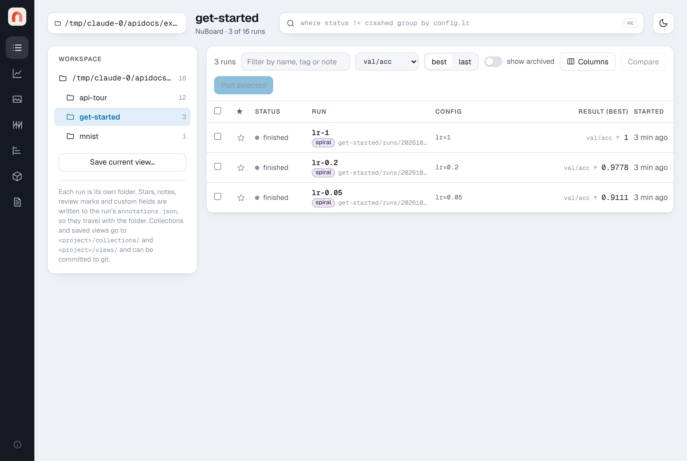
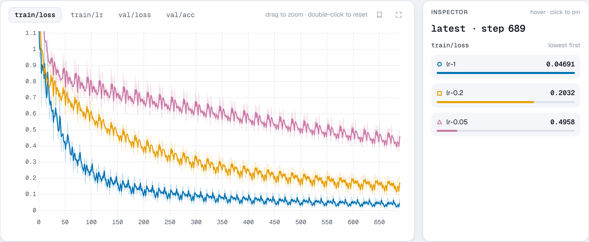
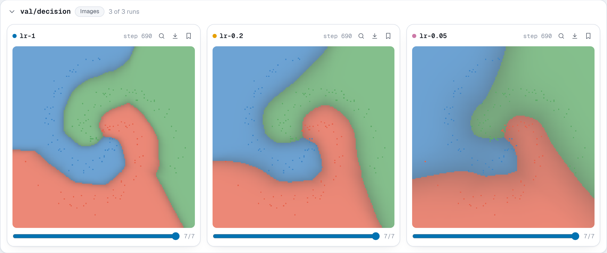
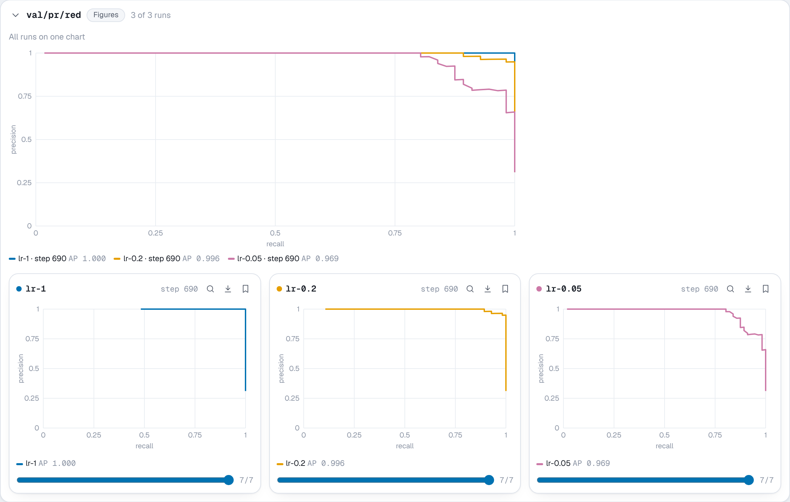
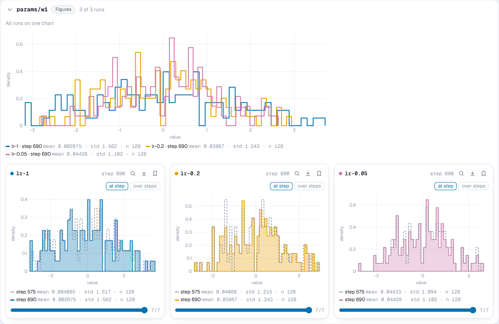
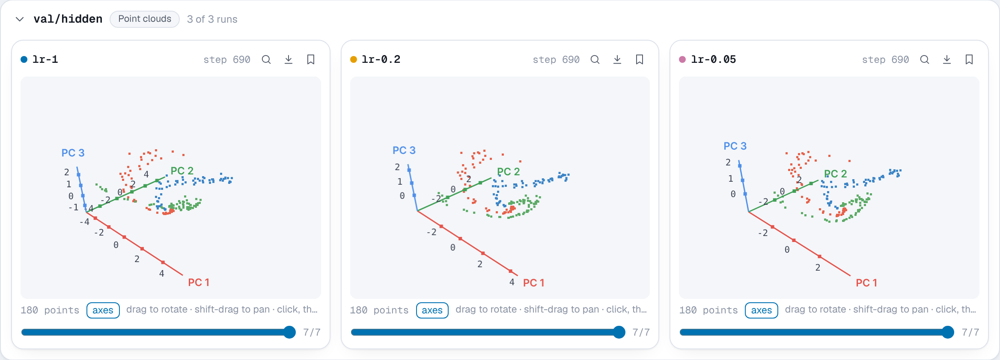
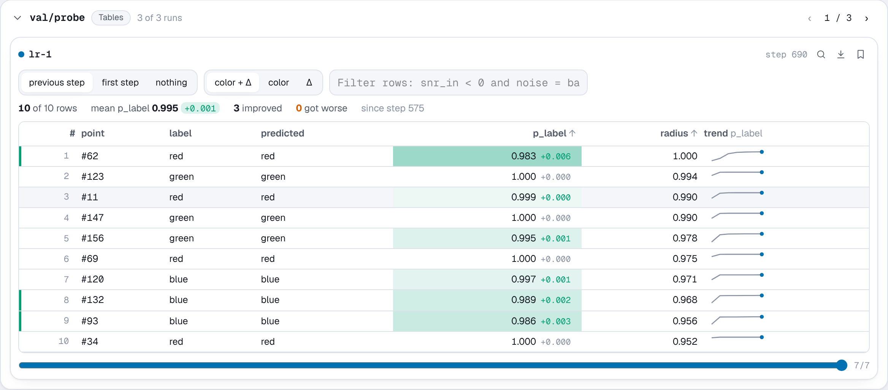

# Get started

This page trains a small network and watches it train in NuBoard. The
network learns to tell apart three interleaved spirals, which is quick to
train on a laptop with nothing but NumPy. Along the way the run logs:

- the training and validation loss and accuracy, as **scalars**;
- a picture of the decision regions, as an **image**;
- a **PR curve** for each class;
- the **distribution** of the weights and their gradients;
- the hidden layer, projected to 3D, as a **point cloud**;
- a **table** following ten hard points through training.

The whole script is `examples/get_started.py` in the repository, shown in
full at the end of this page. The snippets below are its important parts. Each call is described in full
in the [Python API](api/index.md).

## Setup

```bash
pip install "nuboard[viewer]"
```

The `viewer` extra adds the server and NumPy. Logging itself needs only the
standard library, so on a training machine `pip install nuboard` is enough.

## The data and the model

Three spirals of 300 points each, shuffled and split into 720 points to train
on and 180 to validate on:

```python
rng = np.random.default_rng(seed)
x, y = spiral(300, rng)
order = rng.permutation(len(y))
x, y = x[order], y[order]
x_train, y_train, x_val, y_val = x[:720], y[:720], x[720:], y[720:]
```

The model is a network with one hidden layer of 64 ReLU units, trained with
plain SGD in batches of 32. `forward` returns the hidden activations and the
class probabilities, and `backward` returns the loss and the gradients. Any
framework works the same way: NuBoard only sees the numbers and arrays you
pass to it.

## Start a run

`nb.init` creates the run, with its config and tags, and the `with` block
finishes it at the end, or marks it crashed if the script fails:

```python
import nuboard as nb

config = {"lr": lr, "hidden": hidden, "epochs": epochs, "batch_size": 32}

with nb.init("get-started", name=f"lr-{lr:g}", config=config, tags=["spiral"]) as run:
    ...
```

The run is written to `experiments/get-started/runs/<id>/`. Its config shows
in the Runs table and can be queried, such as `where config.lr > 0.1`.

## Log scalars

Log the loss of every batch with `run.log`, at a step that counts batches:

```python
for i in range(0, len(y_train), 32):
    loss, grads = backward(params, x_train[i : i + 32], y_train[i : i + 32])

    for k in params:
        params[k] -= lr * grads[k]

    run.log({"train/loss": loss, "train/lr": lr}, step=step)
    step += 1
```

After each epoch, evaluate on the validation set and log at the step training
reached, so both curves share an x axis:

```python
hidden_val, probs = forward(params, x_val)
pred = probs.argmax(1)
val_loss = float(-np.log(probs[np.arange(len(y_val)), y_val] + 1e-9).mean())
run.log({"val/loss": val_loss, "val/acc": float((pred == y_val).mean())}, step=step)
```

`run.log` does not wait for the disk, so logging every batch costs
microseconds. The part of each key before the `/` makes a section in the
viewer: `train` and `val`.

## Log media

Every five epochs, log what numbers alone do not show:

```python
run.add_image("val/decision", decision_image(params, x_val, y_val), step=step)

for c, name in enumerate(CLASSES):
    run.add_pr_curve(f"val/pr/{name}", y_val == c, probs[:, c], step=step)

for k in ("w1", "w2"):
    run.add_histogram(f"params/{k}", params[k], step=step)
    run.add_histogram(f"grads/{k}", grads[k], step=step)

centered = hidden_val - hidden_val.mean(0)
pca = centered @ np.linalg.svd(centered, full_matrices=False)[2][:3].T
run.add_point_cloud(
    "val/hidden", pca, step=step, colors=PALETTE[y_val], axes=("PC 1", "PC 2", "PC 3")
)

run.add_table(
    "val/probe",
    [
        {
            "point": f"#{i}",
            "label": CLASSES[y_val[i]],
            "predicted": CLASSES[pred[i]],
            "p_label": float(probs[i, y_val[i]]),
            "radius": float(np.hypot(*x_val[i])),
        }
        for i in probe
    ],
    step=step,
)
```

- `decision_image` returns a `(160, 160, 3)` `uint8` array, the predicted
  class over the plane with the validation points on top.
- A PR curve per class compares that class against the other two.
- The histograms show whether the weights grow and the gradients shrink.
- The point cloud is the hidden layer reduced to three dimensions with PCA,
  colored by the true class. As the network learns, the classes pull apart.
- The table logs the same ten points every time, the outermost ones, which
  are the hardest. The viewer matches rows by their first column, `point`, and
  shows how each one changed.

## Train three learning rates

The script trains the same network with three learning rates, one run each:

```python
for lr in (0.05, 0.2, 1.0):
    train(lr)
```

```console
$ python examples/get_started.py
lr=0.05: val/acc 0.911, logged to experiments/get-started/runs/20261017-0932_lr-0.05_ipbnxh
lr=0.2: val/acc 0.978, logged to experiments/get-started/runs/20261017-0932_lr-0.2_meynve
lr=1: val/acc 1.000, logged to experiments/get-started/runs/20261017-0932_lr-1_hxxxiz
```

## Open the viewer

```bash
nuboard up experiments
```

and open <http://localhost:6070>. The viewer can also be started while
training runs: it picks up new points every couple of seconds.

### Runs

The **Runs** page lists the three runs with their config, tags, the result
of a metric you pick (here the best `val/acc`) and how long they took. Click a
run's name for its details: the full config, git commit, installed packages
and command line, recorded by `nb.init`.



### Charts

Select the three runs and press **Plot selected**. Each key is a chart with a
line per run. The highest learning rate learns fastest here; the lowest has
not converged after 30 epochs. Drag on a chart to zoom, and double-click to
reset.



### Media

**Media** shows everything logged with `add_*`, a section per key and a card
per run. Each card has its own step slider, so you can scroll one run through
training while the others stay put.

The decision regions, at the last step, for the three runs:



The PR curves of one class, overlaid for the three runs above the cards:



The weights of the first layer, at the last step against the step before it,
and over steps:



The hidden layer of the best run, rotated with the mouse:



The probe table, with each cell tinted by how it changed since the step
before:



## What next

- The [Python API](api/index.md) describes every call, with the arguments it
  takes and what it stores.
- [Using the viewer](guide/viewer.md) covers queries, grouping runs into mean
  and spread bands, comparing runs, properties and tags.
- [Reports](guide/reports.md) turn charts and media into a Markdown page you
  can export as one HTML file.
- [Sweeps](guide/sweeps.md) shows which hyperparameters matter.

## The whole script

??? example "examples/get_started.py"

    ```python
    """Train a small NumPy network on a spiral and log it to NuBoard.

    The script behind the Get started page of the docs. It needs only NumPy.

        python examples/get_started.py
        nuboard up experiments
    """

    import numpy as np

    import nuboard as nb

    CLASSES = ["red", "green", "blue"]
    PALETTE = np.array([[230, 97, 74], [92, 170, 102], [61, 133, 198]], np.uint8)


    def spiral(n: int, rng: np.random.Generator) -> tuple[np.ndarray, np.ndarray]:
        """Return `n` points per class of three interleaved spirals, and their labels."""

        x, y = [], []

        for c in range(len(CLASSES)):
            r = np.linspace(0.05, 1, n)
            t = np.linspace(c * 4.2, (c + 1) * 4.2, n) + rng.normal(0, 0.25, n)
            x.append(np.stack([r * np.sin(t), r * np.cos(t)], 1))
            y.append(np.full(n, c))

        return np.concatenate(x), np.concatenate(y)


    def init_params(rng: np.random.Generator, hidden: int) -> dict[str, np.ndarray]:
        """Return the weights of a 2-hidden-3 network with a ReLU, He-initialized."""

        return {
            "w1": rng.normal(0, np.sqrt(2 / 2), (2, hidden)),
            "b1": np.zeros(hidden),
            "w2": rng.normal(0, np.sqrt(2 / hidden), (hidden, 3)),
            "b2": np.zeros(3),
        }


    def forward(p: dict[str, np.ndarray], x: np.ndarray) -> tuple[np.ndarray, np.ndarray]:
        """Return the hidden activations and class probabilities for `x`."""

        h = np.maximum(0, x @ p["w1"] + p["b1"])
        z = h @ p["w2"] + p["b2"]
        z = np.exp(z - z.max(1, keepdims=True))
        return h, z / z.sum(1, keepdims=True)


    def backward(
        p: dict[str, np.ndarray], x: np.ndarray, y: np.ndarray
    ) -> tuple[float, dict[str, np.ndarray]]:
        """Return the cross-entropy loss on a batch and its gradients."""

        h, probs = forward(p, x)
        loss = float(-np.log(probs[np.arange(len(y)), y] + 1e-9).mean())
        dz = probs.copy()
        dz[np.arange(len(y)), y] -= 1
        dz /= len(y)
        dh = (dz @ p["w2"].T) * (h > 0)
        grads = {"w2": h.T @ dz, "b2": dz.sum(0), "w1": x.T @ dh, "b1": dh.sum(0)}
        return loss, grads


    def decision_image(p: dict[str, np.ndarray], x: np.ndarray, y: np.ndarray) -> np.ndarray:
        """Return an HxWx3 picture of the predicted class over the plane, with the data."""

        size = 160
        g = np.linspace(-1.1, 1.1, size)
        grid = np.stack(np.meshgrid(g, -g), -1).reshape(-1, 2)
        _, probs = forward(p, grid)
        img = PALETTE[probs.argmax(1)].astype(float) * (0.35 + 0.4 * probs.max(1, keepdims=True))
        img = img.reshape(size, size, 3) + 255 * 0.25
        col = np.clip(((x[:, 0] + 1.1) / 2.2 * (size - 1)).round().astype(int), 0, size - 1)
        row = np.clip(((1.1 - x[:, 1]) / 2.2 * (size - 1)).round().astype(int), 0, size - 1)
        img[row, col] = PALETTE[y]
        return np.clip(img, 0, 255).astype(np.uint8)


    def train(lr: float, hidden: int = 64, epochs: int = 30, seed: int = 0) -> None:
        """Train one network and log its run to the `get-started` project."""

        rng = np.random.default_rng(seed)
        x, y = spiral(300, rng)
        order = rng.permutation(len(y))
        x, y = x[order], y[order]
        x_train, y_train, x_val, y_val = x[:720], y[:720], x[720:], y[720:]
        config = {"lr": lr, "hidden": hidden, "epochs": epochs, "batch_size": 32}
        params = init_params(rng, hidden)
        probe = np.argsort(-np.hypot(*x_val.T))[:10]  # the outermost points, the hardest ones

        with nb.init("get-started", name=f"lr-{lr:g}", config=config, tags=["spiral"]) as run:
            step = 0

            for epoch in range(epochs):
                # 1. Train, logging the loss of every batch
                for i in range(0, len(y_train), 32):
                    loss, grads = backward(params, x_train[i : i + 32], y_train[i : i + 32])

                    for k in params:
                        params[k] -= lr * grads[k]

                    run.log({"train/loss": loss, "train/lr": lr}, step=step)
                    step += 1

                # 2. Evaluate once per epoch, at the step training reached
                hidden_val, probs = forward(params, x_val)
                pred = probs.argmax(1)
                val_loss = float(-np.log(probs[np.arange(len(y_val)), y_val] + 1e-9).mean())
                run.log({"val/loss": val_loss, "val/acc": float((pred == y_val).mean())}, step=step)

                # 3. Media, every five epochs
                if epoch % 5 == 4 or epoch == 0:
                    run.add_image("val/decision", decision_image(params, x_val, y_val), step=step)

                    for c, name in enumerate(CLASSES):
                        run.add_pr_curve(f"val/pr/{name}", y_val == c, probs[:, c], step=step)

                    for k in ("w1", "w2"):
                        run.add_histogram(f"params/{k}", params[k], step=step)
                        run.add_histogram(f"grads/{k}", grads[k], step=step)

                    centered = hidden_val - hidden_val.mean(0)
                    pca = centered @ np.linalg.svd(centered, full_matrices=False)[2][:3].T
                    run.add_point_cloud(
                        "val/hidden",
                        pca,
                        step=step,
                        colors=PALETTE[y_val],
                        axes=("PC 1", "PC 2", "PC 3"),
                    )

                    run.add_table(
                        "val/probe",
                        [
                            {
                                "point": f"#{i}",
                                "label": CLASSES[y_val[i]],
                                "predicted": CLASSES[pred[i]],
                                "p_label": float(probs[i, y_val[i]]),
                                "radius": float(np.hypot(*x_val[i])),
                            }
                            for i in probe
                        ],
                        step=step,
                    )

        print(f"lr={lr:g}: val/acc {float((pred == y_val).mean()):.3f}, logged to {run.path}")


    if __name__ == "__main__":
        for lr in (0.05, 0.2, 1.0):
            train(lr)
    ```
