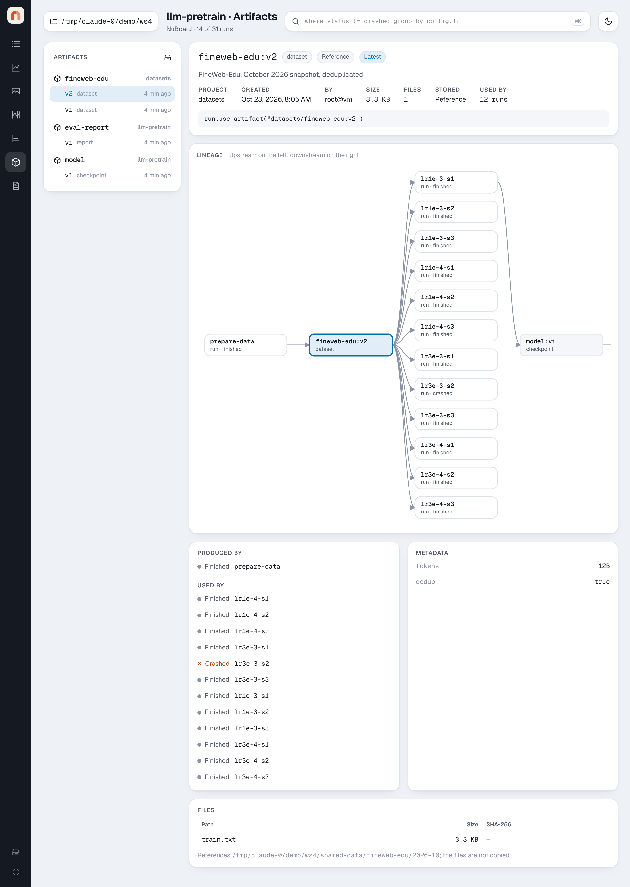

# Artifacts and lineage

Artifacts are versioned folders of files, such as datasets, tokenizers,
checkpoints and evaluation reports, stored inside the project:

```text
llm-pretrain/artifacts/
  fineweb-edu/
    v1/manifest.json  v1/files/…
    v2/manifest.json  v2/files/…
  model/
    v1/manifest.json  v1/files/model.safetensors
```

## Logging and using them

```python
with nb.init("llm-pretrain", name="prepare-data") as run:
    run.add_artifact("fineweb-edu", "data/", type="dataset", metadata={"tokens": "12B"})

with nb.init("llm-pretrain", name="lr1e-3-s1") as run:
    ds = run.use_artifact("fineweb-edu:latest")  # or "fineweb-edu:v2"
    train(ds.files)
    run.add_artifact("model", "ckpt/", type="checkpoint")
```

`add_artifact` copies the files, hashes them (SHA-256) and claims the next
version number atomically, so two runs can publish the same name at once.
Both calls are recorded in the run's `run.json` (`outputs` and `inputs`),
which is what the lineage graph is built from.

## The Artifacts page

{ .nb-shot }

- **List**: every artifact of the project (or of all projects), newest
  version first, with its type and age.
- **Version**: type, creation time, size, file count, how many runs used it,
  and the `use_artifact` line to copy into a script.
- **Lineage**: upstream on the left, downstream on the right. For
  `fineweb-edu:v2` in the demo that is the run that prepared it, the twelve
  training runs that used it, the checkpoint one of them saved, and the
  evaluation that loaded the checkpoint. Click an artifact to move the graph to
  it, or a run to open it.
- **Produced by / Used by**, **Metadata** and **Files** (path, size, hash),
  plus where the files are on disk.

The Timeline page marks each artifact version as a diamond on the run that
produced it.
