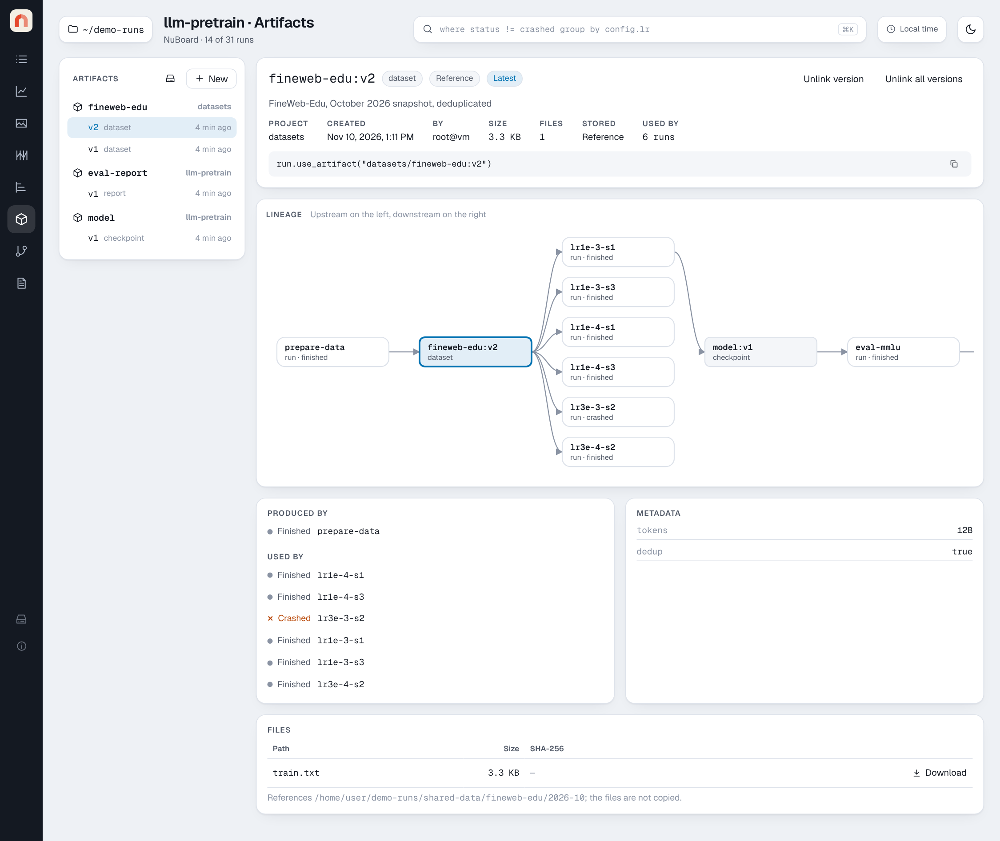

# Artifacts and lineage

Artifacts are versioned datasets, tokenizers, checkpoints and evaluation
reports. Each version records the run that produced it, and each run records
the versions it used, so for any result you can trace the model and the data
behind it.

## Organizing them

A layout that scales to many projects sharing the same data:

- **A `datasets` project** holds your datasets as *references*: NuBoard
  records where the files are and a fingerprint of each one, and copies
  nothing. The data stays on your storage.
- **Each training project** uses them by name, `"datasets/<name>:v<N>"`, and
  saves its checkpoints and reports as its own artifacts.
- **One name per kind of thing** (`fineweb-edu`, `tokenizer`, `model`), with
  new versions piling up under it. Put what describes a version (rows, step,
  score) in `metadata`, not in the name.

```text
experiments/
  datasets/artifacts/            only manifests: where the data is, and its fingerprint
    fineweb-edu/v1/manifest.json     → /data/fineweb-edu/2026-09
    fineweb-edu/v2/manifest.json     → /data/fineweb-edu/2026-10
    imagenet-100/v1/manifest.json    → /data/imagenet-100
  llm-pretrain/
    runs/…                       each run lists datasets/fineweb-edu:v2 as an input
    artifacts/model/v1/          checkpoints are copied: files/model.safetensors
  vit-ablations/
    runs/…                       each run lists datasets/imagenet-100:v1 as an input
```

## Registering data

Data that no script produced, such as a download or a folder prepared by
hand, is registered without a run:

```python
import nuboard as nb

nb.add_artifact("datasets", "imagenet-100", "/data/imagenet-100", type="dataset",
                metadata={"classes": 100}, reference=True)
```

Data that a script prepares is registered from that script's run, which then
shows as its producer:

```python
with nb.init("llm-pretrain", run_name="prepare-data", tags=["data"]) as run:
    ...  # write /data/fineweb-edu/2026-10
    run.add_artifact("datasets/fineweb-edu", "/data/fineweb-edu/2026-10",
                     type="dataset", metadata={"tokens": "12B"}, reference=True)
```

A reference stores each file's size and modification time, which takes a
moment even for terabytes. Add `checksum=True` to also hash every file, which
reads all of the data once.

### From the command line

`nuboard artifact add` registers a version without writing Python. Give
everything as flags, as in a script or a cluster job:

```bash
nuboard artifact add datasets/fineweb-edu ~/data/fineweb-edu/2026-10 --reference \
    --type dataset --description "FineWeb-Edu, Oct 2026 snapshot, deduplicated" \
    --meta tokens=12B --meta dedup=true --meta rows=1200000
```

Or run `nuboard artifact add` alone (or with some of the flags) in a
terminal, and it asks for the rest one field at a time. Every answer is
checked as soon as you enter it, so a mistake is caught on the spot and asked
again:

```text
$ nuboard artifact add
Project/name (such as datasets/fineweb-edu): fineweb-edu
  ✗ give the project too, as in datasets/fineweb-edu
Project/name (such as datasets/fineweb-edu): datasets/fineweb-edu
  ✓ will be fineweb-edu:v3
Path (the file or folder; ~ and $VARS work): ~/data/fineweb-edu/2026-10
  ✓ 1,204 files, 812 GB
Store (copy, or reference to leave the files where they are) [copy]: reference
Type (dataset | model | checkpoint | report | other, or any word): dataset
Description (what this version is): FineWeb-Edu, Oct 2026 snapshot, deduplicated
Hash every file? (y reads all the data once; n is quick) [n]:
Metadata (optional)
  key=value adds or replaces · 2 key=value edits line 2 · -2 deletes line 2 · key:int=5 sets the type · < back · Enter when done
metadata> tokens=12B
  1  tokens = "12B"  (text)
metadata> rows=1200000
  1  tokens = "12B"  (text)
  2  rows = 1200000  (int)
metadata>

Review
  1  name         datasets/fineweb-edu  (new version v3)
  2  path         ~/data/fineweb-edu/2026-10  (1,204 files, 812 GB)
  3  store        reference
  4  type         dataset
  5  description  FineWeb-Edu, Oct 2026 snapshot, deduplicated
  6  checksum     no
  7  metadata     tokens="12B" (text), rows=1200000 (int)
Write it? y = write · 1-7 = change · < back · q = quit: y
Added datasets/fineweb-edu:v3 (reference, 1,204 files, 812 GB)
Use it with: run.use_artifact("datasets/fineweb-edu:v3")
```

- **`<`** goes back one field; earlier answers are kept as the defaults.
- **Metadata** values are typed as you enter them: whole numbers are ints,
  other numbers floats, `true` and `false` booleans, and the rest text.
  `key:str=0001`, `key:int=…`, `key:float=…`, `key:bool=…` and `key:json=[…]`
  set the type yourself.
- **The review** lists everything; enter a field's number to change it.
  Nothing is written until you answer `y`, and `q` or Ctrl-C leaves without
  writing.

Required are the name, the path, `--reference` or `--copy`, the type and the
description. The type is any one word, as in Python: `dataset`, `model`,
`checkpoint`, `report` and `other` are suggested (a prefix such as `ch`
completes them), and others such as `tokenizer` are kept as typed. Without a
terminal, or with `--no-input`, a missing value is an error rather than a
question, and every invalid flag is reported at once. `--meta-file meta.json`
reads metadata from a JSON object, `--checksum` hashes referenced files, and
`--dry-run` checks everything without writing.

`nuboard artifact ls [PROJECT]` lists the versions, and
`nuboard artifact show datasets/fineweb-edu:v3` prints one, with who added
it, and checks that its files are still there and unchanged.

## Using them

```python
with nb.init("llm-pretrain", run_name="lr1e-3-s1") as run:
    data = run.use_artifact("datasets/fineweb-edu:v2")  # or ":latest"
    train(MyDataset(data.files / "train"))
    run.add_artifact("model", "ckpt/final.safetensors", type="checkpoint",
                     metadata={"step": 25000})
```

`use_artifact` returns an `Artifact` whose `files` is a path; NuBoard does not
open or unpickle anything, so you load the data with your own code.
Before returning, it compares the files with the manifest by size, and
warns about any that are missing or whose size changed since the version was
registered. Inside the run's own project, the project can be left
out: `run.use_artifact("model:v1")`.

To find a version without recording it, such as in a notebook, use
`nb.get_artifact("datasets/fineweb-edu:v2")`.

### Reading a version's files

A version is a set of files, even when it holds one, so `files` is always a
folder: the one the files are stored under. The version itself reads like a
mapping from each file's path inside it (as the manifest lists it, with `/`
separators) to the file on this machine:

```python
model = run.use_artifact("model:latest")
list(model)               # ["best.pt"]: what the version holds
"best.pt" in model        # True
model["best.pt"]          # Path to the file, for a copy or a reference
len(model)                # 1

data = run.use_artifact("datasets/fineweb-edu:v2")
data["train/shard-000.bin"]  # files in subfolders too
```

Only the files the version listed when it was made are keys. For a
reference to one file, `files` is the folder that file sits in, which may hold
other files; they are not part of the version, and `model["other.pt"]` raises
a `KeyError` naming the files it does list. A file added to a referenced
folder later is not part of the version either. Prefer the mapping to
listing `files` yourself.

## Data on several machines

When the data has a copy on each machine, such as on a laptop for evaluation
and on a cluster for training, set `NUBOARD_DATA_DIR` on each one to the
folder that holds the datasets there:

```bash
export NUBOARD_DATA_DIR=~/data          # laptop
export NUBOARD_DATA_DIR=/scratch/data   # cluster
```

A reference to a path inside that folder is stored relative to it, as
`${NUBOARD_DATA_DIR}/fineweb-edu/2026-10`, and `artifact.files` points at the
copy of the machine that runs the script. Registered once, the same
`datasets/fineweb-edu:v2` works on both. Any other environment variable
works too when written in the path:

```python
nb.add_artifact("datasets", "imagenet-100", "${IMAGENET}/train", reference=True)
```

The copies are compared by size only, since copying gives files new
modification times. If a variable is not set where the artifact is used,
`use_artifact` warns and names it.

## Copies or references

| | Copy (default) | Reference (`reference=True`) |
| --- | --- | --- |
| Where the files are | `<project>/artifacts/<name>/v<N>/files/` | where they were |
| Disk | a second copy | nothing beyond the manifest |
| If the source is deleted or changed | the version is unaffected | `use_artifact` warns when a file is missing or its size changed |
| Fingerprint | SHA-256 | size and modification time, SHA-256 with `checksum=True`; checked by size |
| On another machine | the same files | that machine's copy, through `$NUBOARD_DATA_DIR` |
| Good for | checkpoints, reports, small datasets | datasets on shared storage |

## From a run's files

A checkpoint or an evaluation output saved into a run's folder can become an
artifact version afterwards, without changing the run:

- **Copy** (the default) copies the file or folder into the version and
  hashes it. The version stays the same whatever happens to the run.
- **Reference** copies nothing. Because the files are inside the project, the
  manifest stores their path relative to the project
  (`runs/<run>/files/best.pt`), not an absolute path, so the project can be
  copied, rsynced, zipped or merged and the version still finds them. A run
  still running cannot be referenced, since its files may change.

Either way the run is the version's producer (`producer_run`), and the
version's `source` records the run and the path. `nuboard rm` keeps a run
whose files a linked version references, and says which versions; unlink
them first, or pass `--force` (the versions then report their files as
missing).

From the viewer, use **New artifact version** in the run's Files tab (with
`--edit-artifacts`). From the command line, `nuboard artifact add` with a path
inside a run of the same project does the same:

```bash
nuboard artifact add llm-pretrain/best \
    experiments/llm-pretrain/runs/20261103T1504-90c3affc/files/best.safetensors --copy
```

From Python, `promote_run_path` takes the run folder and the path inside it:

```python
from nuboard.artifacts import promote_run_path

promote_run_path(run_dir, "files/checkpoints/step_06000", "best", copy=False, type="checkpoint")
```

## Recommendations

A version's manifest lists every file it holds, and each `use_artifact`
checks every file in it. That is cheap for a few thousand files and becomes
slow with hundreds of thousands, so register data in a shape that keeps the
list short:

- **Reference large files, not millions of small ones.** Twenty HDF5 files of
  3 GB each are a 20-line manifest and take a second to add. A folder of a
  million images is a manifest of about 100 MB, written in tens of seconds
  on a local disk and minutes on network storage, and every `use_artifact`
  then stats a million files. Pack such data into shards (tar, Parquet,
  HDF5, WebDataset) and reference the shards, or reference a single index
  file that lists the samples. The viewer's form warns from 10,000 files.
- **Hash only what you need to prove.** `checksum=True` (or **Checksum** in
  the form) reads every byte: roughly a minute per 30 GB on a fast local
  disk, several on network storage. The hashes are stored, not re-checked; a
  later check is by size only. Use it for a frozen dataset you want a
  record of, and leave it off for data you register often.
- **Treat a version as a snapshot.** A change that keeps a file's size, such
  as an HDF5 file rewritten in place, is not noticed. When the data changes,
  add a new version instead of editing the files behind an existing one.
- **Copy small things, reference big ones.** Checkpoints, tokenizers and
  reports are worth a copy, so the version survives the source being deleted.
  Datasets on shared storage are better referenced.
- **Undo a mistake with unlink.** `nuboard artifact unlink
  datasets/fineweb-edu:v3` (or **Unlink version** in the viewer) hides a
  version without deleting anything, and `nuboard artifact restore` brings it
  back. See [Unlinking](#adding-and-unlinking-versions-in-the-viewer).

## The Artifacts page

{ .nb-shot }

- **List**: every artifact, newest version first, with its project, type and
  age. With a project selected, it shows that project's artifacts and those
  its runs used from other projects.
- **Version**: type, whether it is a copy or a reference, creation time,
  size, file count, how many runs used it, and the `use_artifact` line to copy
  into a script.
- **Lineage**: upstream on the left, downstream on the right. For
  `fineweb-edu:v2` in the demo that is the run that prepared it, the twelve
  training runs that used it, the checkpoint one of them saved, and the
  evaluation that loaded the checkpoint. Click an artifact to move the graph to
  it, or a run to open it.
- **Produced by / Used by**, **Metadata** and **Files** (path, size, hash),
  plus where the files are on disk. Files load 1,000 at a time, with
  **Show more** and a path filter, so a version with many files opens at
  once. A version added with `nb.add_artifact`
  shows "Logged outside a run".

The Timeline page marks each artifact version as a diamond on the run that
produced it.

### Adding and unlinking versions in the viewer

The Artifacts page is read-only unless the viewer was started with
`nuboard up --edit-artifacts`. With it:

- **+ New** opens a form that adds an artifact, or a version of one, as a reference, like
  `nuboard artifact add --reference`. Pick the project, type a new or existing
  name, and give the path of a file or folder: absolute, starting with `~` or
  an environment variable such as `$NUBOARD_DATA_DIR/fineweb-edu`, or relative
  to the served folder. The form checks the path as you type and shows what
  it resolved to, with the file count and size. Add a type (any word; as you
  type, the built-in ones and those other artifacts already use are suggested,
  such as Dataset or Checkpoint), a description,
  metadata (text, number, yes/no or JSON) and, if you want, SHA-256 checksums,
  then review and add. Nothing is copied, and the viewer cannot upload files;
  use `nuboard artifact add --copy` or `nb.add_artifact` for a copy.
  A path inside a project's `artifacts/` folder, or one that contains it (such
  as the project itself), is refused, since the version would list other
  versions.
- If the files are the same as the artifact's latest version (same paths and
  sizes, and the same SHA-256 or modification time), the form says so and
  offers **Add anyway** instead of silently adding an identical version.
- **New artifact version** in a run's **Files** tab makes a version from a
  file of that run (the button next to **Download**), or from a folder (the
  artifact icon on the folder's row). It opens the same form, with the
  project fixed to the run's, the source filled in, and a choice of how to
  store it (see [From a run's files](#from-a-runs-files)). The run is
  recorded as the version's producer; its folder is never changed.
- **Unlink version** (or **Unlink all versions**) asks for confirmation, then
  moves the version folder to `artifacts/.unlinked/` in the project. No files
  are deleted, and a referenced dataset is never touched. The version leaves
  the list and `use_artifact`, and runs that used or produced it show it as
  "(unlinked)". Its number is not reused.
- **Show unlinked** lists unlinked versions; **Restore** puts one back.

Without `--edit-artifacts`, **+ New**, **New artifact version** and
**Unlink** are not shown.

The command line does the same without the viewer:

```bash
nuboard artifact unlink datasets/fineweb-edu:v3      # one version
nuboard artifact unlink datasets/fineweb-edu --all   # every version
nuboard artifact ls --unlinked                        # list them, marked (unlinked)
nuboard artifact restore datasets/fineweb-edu:v3
```

Deleting data is left to you: remove a folder under `artifacts/.unlinked/`
yourself when you no longer need it.
