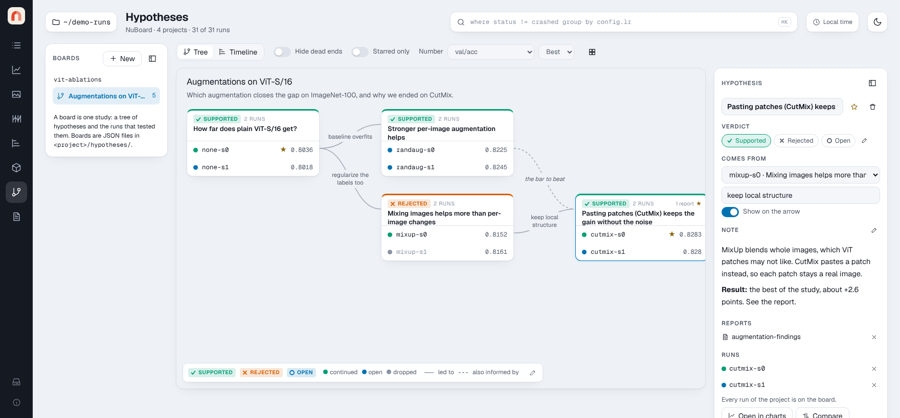

# Hypotheses

The **Hypotheses** page keeps the story behind your runs: what you were
testing, which runs tested it, what you concluded, and which run gave you the
next idea. Its **Board** view draws that story as a tree of cards you read
left to right; its **Timeline** view lists the same runs by date.

{ .nb-shot }

Try it on the demo: `nuboard demo demo-runs --up --open`, then open
**Hypotheses** in the left rail. The board *Augmentations on ViT-S/16*, in
`vit-ablations`, goes from a baseline to RandAugment and MixUp,
then to CutMix, and ends on a planned card that has no runs yet.

## Boards, cards and arrows

- A **board** is one tree of hypotheses in a project. A project can have
  several boards, one per study. The **Hypotheses** list on the left shows every
  project's boards (or only the project picked in the workspace), like the
  Reports list; press **New** to start one. `[` folds the list. Each board can have a title and a
  description, shown above the cards.
- A **card** is a hypothesis: a question or an idea, the runs that tested
  it, and a **verdict** (by default Supported, Rejected or Open), shown as a
  badge and as the color of the card's top edge.
- Each run on a card has an **outcome**: did you keep building on it? By
  default it is Continued, Open or Dropped. Dropped is a *dead end*: it is
  struck through, and **Hide dead ends** hides it.
- An **arrow** leads from a run to the hypothesis it led to. Its text says
  why. Click the text to edit it, or the small **+** on an arrow without text
  to add some. Clear the text to show a bare arrow.
- A **dashed arrow** ("also informed by") shows that another run fed into the
  idea without being its parent.

A run belongs to at most one hypothesis on a board, but the same run can
appear on several boards.

## Working with the board

- **Start**: press **+** at the start of the bar at the bottom of the board
  (or click the empty canvas to clear the selection) and fill in the form in the side panel: the
  question and, if you like, the runs that test it: **Add a run…** lists
  each one with an × to take it off again, as on a card. A board can have
  several starting points; a hypothesis with nothing under **Comes from** is
  one.
- **Add runs**: open a card and use **Add a run…**. The list offers the
  project's runs that are not on the board yet. Every run picker on the page
  (**Add a run**, **Comes from**, **Add a dashed link**) shows
  each run with its status, start time, tags and the end of its id
  (`c44aa583`), so runs with the same name can be told apart, and filters by
  name, id, status, tag or notes, with the same rule as every filter box
  (`!crashed` leaves runs out; see [Filter boxes](viewer.md#filter-boxes)). With nothing selected, **Not on the board** lists
  the five newest runs that are on no card (**Show all** or the filter reaches
  the rest); click one to add it to the new hypothesis's runs.
- **Follow up**: click a run, write the next hypothesis under **Follow up**
  and say why. The new card appears to the right with an arrow from that run.
- **Write it down**: a card has a Markdown note and can link the project's
  reports. A run has a conclusion. Both show in the side panel on the right,
  which folds away with its sidebar button. A run's conclusion and the **Why**
  of an arrow save with **Save** (or Ctrl/Cmd+Enter, Enter for Why), and
  **Cancel** or Esc puts the saved text back. An unsaved draft stays while you
  look at other runs, and leaving the page with one asks first.
- **A run's metrics**: the side panel lists the run's status, start time,
  tags and id (click the id to copy all of it), then its **Metrics**. By
  default these are the card's metric (with its Min, Max or Last) and the
  run's first metrics, without system metrics and timers. The pencil next to
  **Metrics** picks them for the whole board, so every run shows the same
  rows; drag a row (or Alt+↑/↓) to reorder, **Use default** to go back.
- **Star** runs and cards that matter. **Starred only** keeps just the paths
  through them.
- **The number on each run** is one metric, picked under **Number** in the
  toolbar, with a **Min / Max / Last** pill next to it for which value.
  Each card marks its top run's number (▲, in the accent color): the lowest
  for Min, the highest for Max, and for Last the end that is better by the
  metric's direction in the project, the same one Runs and Sweeps use (see
  [Which way is better](viewer.md#which-way-is-better)). It is set there, not
  on this page; until it is, it is guessed from the name. Hover a ▲ to see
  which end it is. A metric starts on Min when its name reads as a loss or
  error, else on Max.
  A card can pick its own under
  **Number on this card** in the side panel: a metric menu, with a
  **Min / Max / Last** pill under it. Its header then names that metric. Hover a number
  to see which metric and value it is.
- **Compare**: Shift-click runs, on one card or across cards, to open them
  together in **Charts** or **Compare**. A card's **Open in charts** does the
  same for all of its runs.
- **Hover** a run or a card to highlight the path through it.
- **Fold**: cards with more than five runs fold to their key runs (starred,
  top, running, missing, selected, and runs an arrow starts from). Click
  **N runs ⌄** under the verdict to fold or unfold.
- **Arrange**: drag a card by its header to move it. The grid button puts
  every card back in its automatic place.
- **Card size**: **S / M / L / XL** in the toolbar sets how wide cards are,
  for longer titles and run names; **Card size** in a card's side panel
  overrides it for that card (**Board** follows the toolbar). Each column of
  the tree is as wide as its widest card, so arrows keep the same length.
- **Categories**: the pencil at the end of the legend edits the verdicts
  (name, color, icon) and the outcomes (name, color, dead end) of the board.
  Each list holds up to eight.

**Timeline** (next to **Board** in the toolbar) lists the runs of the board in the order they started, with one
lane per hypothesis and a curve where a hypothesis grew out of an earlier run.
Its header names the board's number (such as `val/acc MAX`); a run whose card
has its own number names that metric under the value, and the column widens
to fit it. Names show whole when there is room; on a narrow window they keep
their end (`…/EarlyStopping.on_val_end`); hover for the whole name.

## Missing runs and reports

A board refers to runs by id and to reports by name. When a run is deleted,
moved or not loaded, its row stays on the card, greyed out and marked
**not found**, with its conclusion kept. Remove it from the side panel if it
is gone for good. A linked report that no longer exists shows the same way.
A board with a broken or hand-edited file still opens: unreadable files are
skipped and unknown values fall back to defaults.

## Where it is stored

Each board is a folder of plain JSON in the project,
`<project>/hypotheses/<board>/`, with `board.json` for the board and one
`<id>.json` per hypothesis. You can commit it to git with the project, or edit
it by hand. See [File format](../reference/format.md#hypothesis-boards-hypothesesboard).

`nuboard up --read-only-reports` makes boards read-only too.
