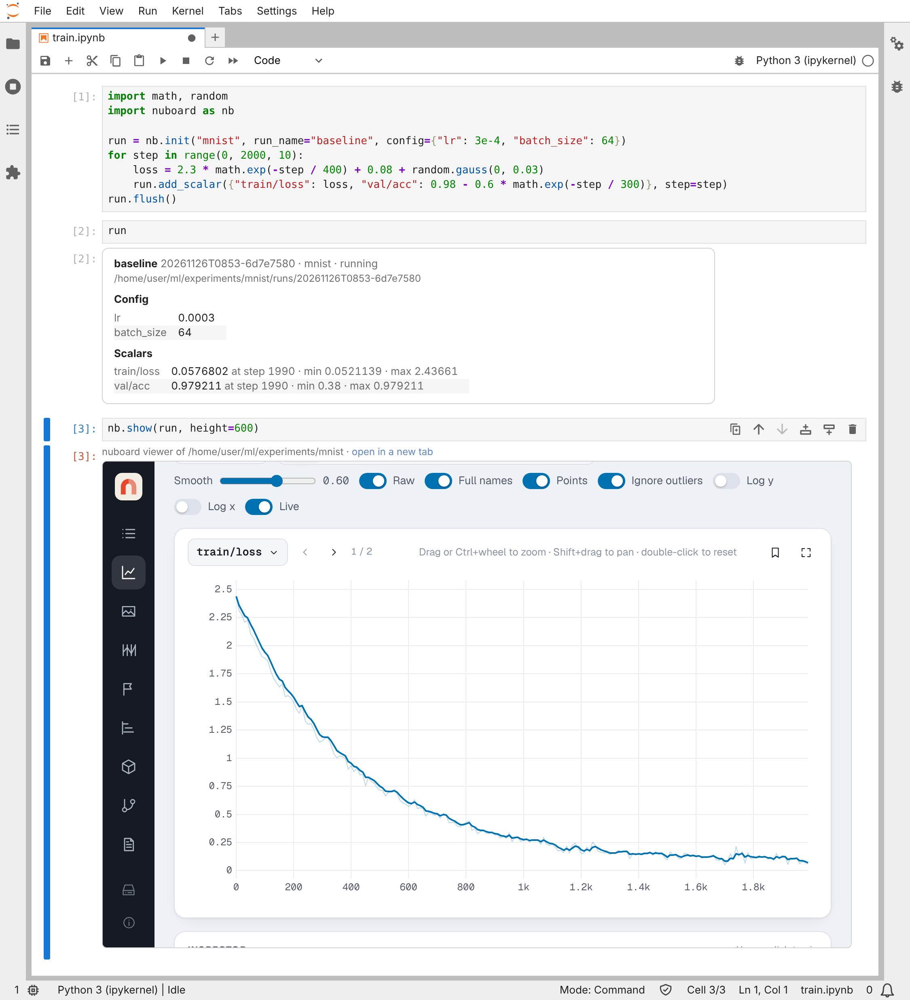

# Frameworks and notebooks

NuBoard plugs into PyTorch Lightning, the Hugging Face `Trainer` and Jupyter
without adding a dependency. Each integration lives in its own module and uses
the framework your script already has; `import nuboard` never imports one.

## PyTorch Lightning

```python
import lightning as L
from nuboard.integrations.lightning import NuBoardLogger

logger = NuBoardLogger("mnist", run_name="baseline", tags=["cnn"])
trainer = L.Trainer(max_epochs=10, logger=logger)
trainer.fit(model, datamodule)
trainer.test(model, datamodule)
```

- Every `self.log(...)` becomes a scalar at the trainer's global step.
- `self.save_hyperparameters()` goes into the run's config, together with
  `config=` if you pass one.
- Only global rank 0 creates and writes the run, so the same logger works
  with any strategy (DDP, FSDP, ...).
- The run is finished when `fit`, `validate` or `test` ends: `finished` on
  success, `crashed` on an exception. Using the trainer again (a `test` after a
  `fit`) resumes **the same run** as a new session, so one run holds the
  training and the test scores.
- For images, figures, audio and text, log on the run itself:
  `self.logger.experiment` is the `nb.Run`.

```python
def validation_step(self, batch, i):
    ...
    if i == 0:
        self.logger.experiment.add_image("val/samples", grid, step=self.global_step)
```

`log_model=True` records the best checkpoint of your `ModelCheckpoint` (the
last one without a monitored metric) as a `"checkpoint"` artifact version named
`model` (`model_name=` to change it) when the run ends, with the monitored
metric and score in its metadata. Checkpoints themselves stay where Lightning
writes them, under `default_root_dir`.

Every other keyword goes to [`nb.init`](../api/init.md), such as `group`,
`notes`, `dir`, `run_id` and `resume`. To log into a run you opened yourself,
pass `run=`: the logger then never finishes it. Both `lightning` and the older
`pytorch_lightning` package work.

## Hugging Face Trainer

```python
from transformers import Trainer, TrainingArguments
from nuboard.integrations.huggingface import NuBoardCallback

args = TrainingArguments("out", report_to="none", logging_steps=20, eval_strategy="epoch")
trainer = Trainer(model, args, train_dataset=train, eval_dataset=val,
                  callbacks=[NuBoardCallback("glue-mrpc")])
trainer.train()
trainer.evaluate()
```

- Whatever the trainer logs becomes a scalar at its global step: keys that
  start with `eval_` go under `eval/` (`eval/loss`), `test_` under `test/`,
  and the rest under `train/` (`train/loss`, `train/learning_rate`,
  `train/grad_norm`).
- The `TrainingArguments` are the run's config (tokens masked, as the trainer
  does), with the model's config under `model`.
- Only the main process writes.
- The run starts with `train()` and is finished when training ends.
  `trainer.evaluate()` afterwards resumes the same run as a new session; in a
  notebook, call `callback.finish()` when you are done with it.
- In `trainer.hyperparameter_search`, each trial is a run of its own, with the
  trial's parameters under `trial` in its config.
- `run_name=` names the run; without it, `TrainingArguments.run_name` is used
  when you set one.

Set `report_to="none"` (or leave `"tensorboard"` out of the list) so the
trainer does not add its own loggers as well. `log_model=True` records the
best checkpoint folder (or the newest `checkpoint-<step>`) as a `"checkpoint"`
artifact when training ends. The callback does not need `transformers` to be
imported to work, and ignores events it does not use, including ones newer
versions add.

## Jupyter

{ .nb-shot }

Runs and projects show a summary when they end a cell:

```python
import nuboard as nb

run = nb.init("mnist", config={"lr": 3e-4})
run              # name, status, folder, config and the last value of each scalar

nb.load("mnist")             # the newest runs of the project
nb.load("mnist").run(run.id) # one run read from disk
```

`nb.show()` opens the viewer inside the notebook:

```python
nb.show(run)       # this run's charts, updating as it trains
nb.show("mnist")   # the project's runs
nb.show()          # every project in $NUBOARD_DIR (or ./experiments)
nb.show(run, page="media", height=900)
```

The first call starts the viewer on a free port of this computer, on a
background thread of the kernel, and later calls for the same folder reuse it.
The returned object shows the viewer in the cell, has the address in `.url`
(the frame also links to it, to open in a tab) and stops the viewer with
`.stop()`. The viewer needs nothing beyond `pip install nuboard`.

The viewer listens on `127.0.0.1` only, so the browser showing the notebook
must reach that address: Jupyter and JupyterLab on your computer and VS Code
(which forwards the port of a remote kernel) work as they are. For a kernel on
another machine, forward the port with `ssh -L` and open `.url` in a tab, as in
[Sharing from a cloud machine](sharing.md). Hosted notebooks that serve their
pages from another site, such as Colab, are not supported yet.

A normal viewer refuses to be shown inside another site's page. The one
`nb.show` starts allows it for pages on `localhost` and `127.0.0.1` (any port)
and VS Code; `frame_ancestors=["https://notebooks.example.com"]` adds another
notebook server.
