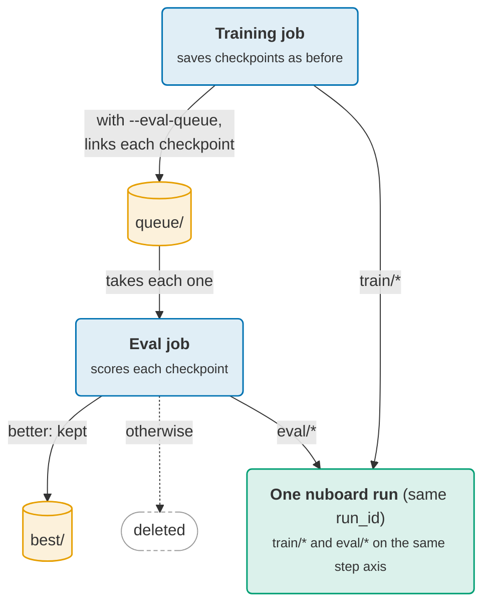

# Evaluating while training

Evaluation that needs a lot of GPU time slows training down when both run in
one job. You can move it to a second job that evaluates checkpoints as they
appear, and still get **one run**: training and evaluation scalars on the same
step axis, one status, one place to look.



## The two jobs

Both jobs use the same run id. The training job creates the run as usual; the
eval job joins it with `job="eval"`:

```python
# train.py
with nb.init("speech", run_name="big", run_id=RUN_ID, config=cfg) as run:
    for epoch in range(epochs):
        ...
        run.add_scalar({"train/loss": loss}, step=epoch)
        path = f"ckpt/epoch_{epoch:03d}.pt"
        torch.save(state, path)                    # as before
        if args.eval_queue:                        # the only change for a second job
            enqueue(path, args.eval_queue)
    if args.eval_queue:
        open(f"{args.eval_queue}/FINISHED", "w").close()
```

```python
# eval.py
with nb.init("speech", run_id=RUN_ID, job="eval") as run:
    while True:
        todo = sorted(p for p in os.listdir(QUEUE) if p.startswith("epoch_"))
        if not todo:
            if os.path.exists(f"{QUEUE}/FINISHED"):
                break
            time.sleep(30)
            continue
        path = f"{QUEUE}/{todo[0]}"
        scores = evaluate(path)                    # {"eval/pesq": ..., "eval/si_sdr": ...}
        run.add_scalar(scores, step=epoch_of(path))
        if is_best(scores):
            os.replace(path, "best/model.pt")
        else:
            os.remove(path)
    run.add_artifact("model", "best/", type="checkpoint")
```

`enqueue` is a few lines of your own: link the checkpoint into the queue under
a temporary name, then rename it, so the evaluator never sees a half-written
file. A hard link is instant and takes no extra space; it only needs the queue
on the same disk and a new file name for each checkpoint:

```python
def enqueue(path, queue):
    dest = os.path.join(queue, os.path.basename(path))
    tmp = dest + ".tmp"
    try:
        os.link(path, tmp)
    except OSError:                                 # another disk: copy instead
        shutil.copy2(path, tmp)
    os.replace(tmp, dest)
```

Each folder has one owner: `ckpt/` is the trainer's, `best/` is the
evaluator's, and `queue/` is where one hands over to the other. Deleting a
queue entry never touches the trainer's checkpoint, which it keeps or prunes
as it always did. Anything still in the queue has not been evaluated, so
either job can be restarted at any time. Without `--eval-queue`, training runs exactly as before, and you can
call the same `evaluate` inside the training loop instead.

## What `job` does

A job other than the main one:

- **joins** an existing run. If no run `run_id` exists, `init` fails, so a
  `job=` left in a training script by mistake cannot start a stray run.
- **logs into the run** like the main job: scalars, media, tables, artifacts.
  Scalars share the step axis, so `eval/pesq` at epoch 12 lines up with
  `train/loss` at epoch 12, whatever order they were logged in.
- **never changes the run's state.** The status, heartbeat and summary in
  `run.json` stay the main job's. The job's own state is in
  `jobs/<job>.json`, its console in `files/output.<job>.log` and its system
  metrics under `system/<job>/`.
- **shows as a chip** next to the run in the viewer, such as `eval` with a
  pulsing ring while it runs or ✕ when it crashed. **All settings** lists every
  job with its status and host.
- **runs once at a time.** Starting a second process with the same job name
  while the first is alive fails with a message naming its host and process.
  A process that was killed stops counting as alive about 30 s after its
  last heartbeat.
- **continues** when restarted, as a new session of the same job.

Log under names of the job's own, such as `eval/*`. If a job logs a name the
main job also logs, `init` warns once: for that scalar, the later job's values
replace the earlier ones from its first step on.

When both jobs have ended, whichever ended last compacts the run into
`data.parquet` with the scalars of both.

Later analyses work the same way: `job="analysis"` adds plots or tables to a
finished run without touching it.
