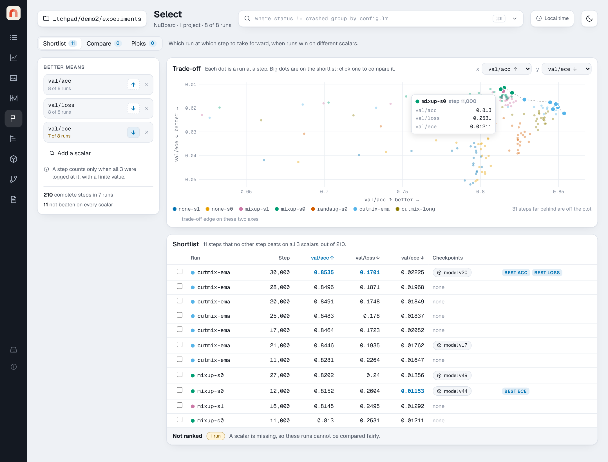

# Choosing a step

After a round of experiments there are often several models that each win on
something: one has the best accuracy, another the best calibration, a third
is faster. The Best step page helps decide which run, at which step, to take
forward. It does not decide for you. It removes the steps that are simply
worse, shows what each of the remaining choices costs, and keeps a note of
what you picked and why.

{ .nb-shot }

Try it on the demo: `nuboard demo demo-runs --up --open`, open **Best step** on
`vit-ablations` and add `val/acc` and `val/calibration_error` under **Better
means**. The eight runs trade accuracy against calibration: CutMix is the
most accurate, MixUp the best calibrated, and later epochs gain accuracy
while calibration drifts back. Checkpoints are saved at epochs 60, 80 and
100, and one pick is already made.

## What a candidate is

A candidate is **one run at one step**, scored on the scalars you already log
for Charts. Nothing new needs to be logged.

A step counts only when **every chosen scalar was logged at it**, with a
finite value. If you log `train/loss` every step and `val/acc` every 1,000
steps, the candidates are the steps where both were logged: every 1,000th.
Log the scalars you want to judge by together, at the same step, as an
evaluation usually does.

## The shortlist

Add the scalars that matter under **Better means**, and check the arrow next
to each: **↑** higher is better, **↓** lower is better. The arrow comes from
the project's saved directions (see
[Which way is better](viewer.md#which-way-is-better)); a dashed arrow is a guess
from the name. Clicking it flips it for this view only.

The **shortlist** holds the steps that no other step beats on every scalar at
once (the Pareto front). A step that another step matches or beats everywhere
is left out, since there is no reason to choose it. What remains are real
trade-offs: each step on the list is better than every other one on at least
one scalar. **Best** badges mark the best value of each scalar.

The **trade-off plot** shows two of the scalars at a time, with better to the
right and up. Big dots are the shortlist, small dots the other steps, and the
dashed line the edge of what is reachable on those two axes. Steps far behind
(the 10% worst on an axis) are left off so the plot stays on the part where
the choice is made. Click a dot, or tick a row, to compare it.

The plot works like the charts elsewhere:

- **Hover** any dot, big or small, to see its run, step and values: the two
  scalars on the axes first, and up to six in all (the shortlist has every
  one). The run's other steps stand out, and hovering a run in the legend
  does the same.
- **Drag** a box to zoom in. **Ctrl/⌘ + wheel** (or a pinch) zooms around the
  cursor, **Shift + drag** pans, and **double-click** or **Reset zoom** shows
  it all again.
- The buttons at the top right add the plot to a report and show it full
  screen.

### Runs that are not ranked

A run that never logs one of the chosen scalars cannot be compared fairly, so
it is not ranked rather than judged on fewer numbers. Each scalar shows how
many runs log it (such as "7 of 8 runs"), and **Not ranked** under the table
lists the runs left out and what they miss. Removing that scalar ranks them.

## Comparing and picking

**Compare** puts the chosen steps side by side: the value of each scalar (in
bold where it is the best of the steps compared), its rank on the shortlist
(such as "#2 of 15"), and a small curve of the whole run with the step
marked, which shows whether the run was still improving or already drifting.
**Summary** lists, for each step, the scalars it is the best and the worst
on among the steps compared. Below are the config keys that differ and the
artifacts the run logged at that step.

**Pick this step** asks why, and which artifact (such as a checkpoint) goes
with it. The pick is
saved in the project's `picks.json`, with the scalars' values and directions
at the time, so it can be committed to git and read later. **Picks** lists
them; each pick can be opened in Charts, edited or removed.

## Artifacts at a step

The **Artifacts** column lists the artifact versions a run logged, next to
the step they belong to. A checkpoint file saved to disk without
`add_artifact` is not listed: log it as an artifact, with its step:

```python
run.add_artifact("model", "ckpt/", type="checkpoint", step=step)
```

A version without a step (or with a whole-number `step` in its `metadata`) is
placed at the last step logged before it was made, which is right when the
checkpoint is saved after the evaluation. A step can have several
checkpoints, or none: a pick can be made before any checkpoint exists.
