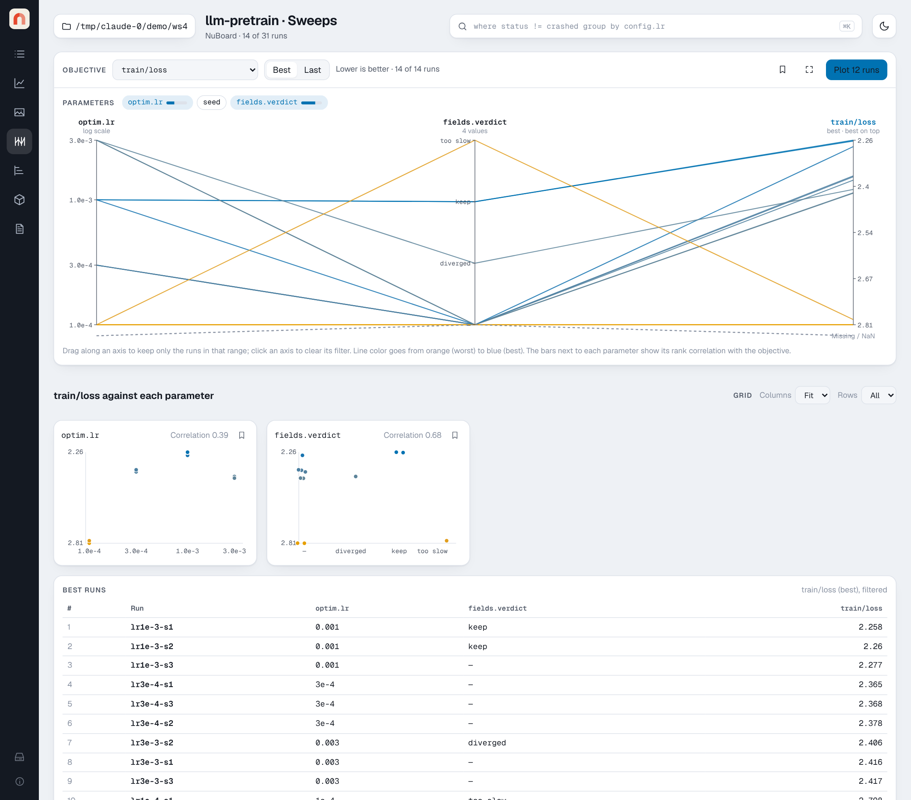

# Sweeps

The Sweeps page answers "which settings matter, and which run is best?" for
any set of runs: a project, a query result or your selection.

{ .nb-shot }

## Logging a sweep

A sweep is nothing special to NuBoard: it is a set of runs, one per trial,
whose config holds the settings being tried. Any search tool works, from a
plain loop over a grid to a library that picks the next settings. Give the
runs a shared `group` or tag so a query can select them.

For example, with [Optuna](https://optuna.org):

```python
import optuna
import nuboard as nb

def objective(trial):
    cfg = {
        "lr": trial.suggest_float("lr", 1e-5, 1e-2, log=True),
        "batch": trial.suggest_categorical("batch", [32, 64, 128]),
    }
    run = nb.init("mnist", run_name=f"trial-{trial.number}", config=cfg,
                  group="lr-batch-search", tags=["sweep"])

    for epoch in range(20):
        val_loss = train_one_epoch_and_eval(cfg)  # your training code
        run.add_scalar({"val/loss": val_loss}, step=epoch)
        trial.report(val_loss, epoch)

        if trial.should_prune():
            run.finish(status="pruned")
            raise optuna.TrialPruned()

    run.finish()
    return val_loss

optuna.create_study(direction="minimize").optimize(objective, n_trials=50)
```

Then open Sweeps on `where tags has "sweep"` with `val/loss` as the
objective. Some notes:

- To stop a trial early, call `run.finish(status="pruned")` (any status
  name works) before raising. A run that is already finished keeps its
  status, even inside `with nb.init(...)`; without that call, an exception
  ending the run records it as `crashed`.
- Trials can run in parallel, in several processes or on several machines:
  each run writes its own folder, so nothing needs to be shared on the
  NuBoard side.

## Objective and parameters

- **Objective**: pick a scalar and whether to use its **Best** value (the
  minimum for losses and errors, the maximum otherwise) or its **Last** value.
  Lower-is-better scalars are flipped so the best runs are always on top.
- **Parameters**: every config key whose value differs between the runs, plus
  properties. Keys with `seed` in the name start unselected. Click a chip to
  add or remove an axis. The bar inside a chip is the parameter's rank
  correlation with the objective: Spearman's ρ for numbers, the correlation
  ratio on ranks for categories. It is a quick hint, not a causal estimate.

Numeric parameters that span more than a factor of 20 use a log axis.
Text and boolean parameters become ordered categories.

## Parallel coordinates

Each run is one line through every parameter axis to the objective axis.
Lines are colored from orange (worst) to blue (best). Runs without a value for
the objective (still starting, or diverged to NaN) are dashed and end below
the axis.

**Drag along any axis** to keep only the runs inside that range. Filters on
several axes combine, and the scatters, best-runs table and **Plot N runs**
button follow them. Click an axis to clear its filter.

The corner button next to **Plot N runs** shows the chart full screen (Esc
leaves), and the bookmark button adds it to a [report](reports.md) as a
snapshot.

## Scatters and best runs

Below the chart, one scatter per parameter plots the objective against it.
**Grid** sets the plots per row (fit to width, or 1 to 6) and the rows per page
(1 to 6, or all), with a pager when there are more; both are remembered and
kept in the URL (`scols`, `srows`). The bookmark button on each scatter adds
it to a report.
The **Best runs** table lists the top ten runs that pass the filters. Click a
run anywhere on the page to open its details on the Runs page, or press
**Plot N runs** to open them on Charts.

All of the page's state (objective, statistic, parameters) is in the URL,
so a sweep view can be bookmarked or saved like any other view.
