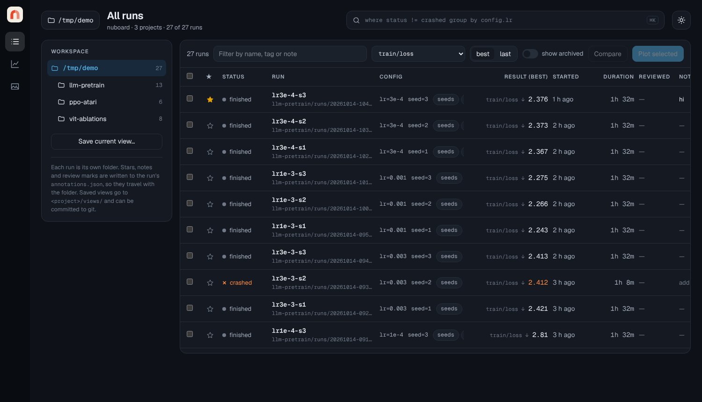
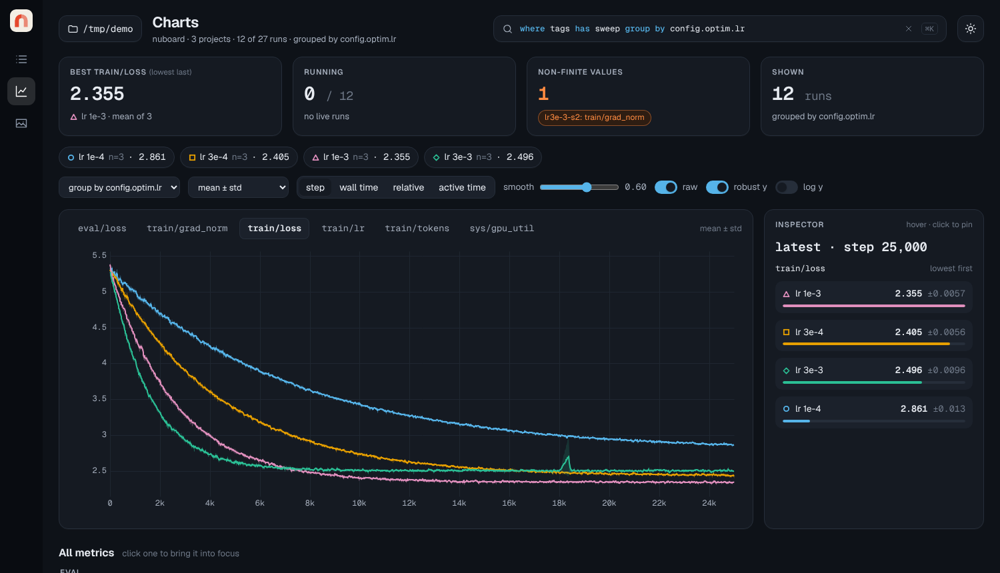

# Using the viewer

```bash
nuboard up ~/exp          # any folder: one run, one project, or many projects
```

The viewer is a single-page app served by a small local Starlette server. All
data stays on your machine. Every piece of view state (query, page, metric,
x-axis, smoothing, zoom, selection, compared runs) is in the URL, so you can
bookmark a view, send the link to yourself on another machine, or save it as a
view file. Per-viewer preferences (theme, default smoothing) live in your
browser's local storage.



## Header

- **Folder chip**: the served folder; click it to go back to all runs.
- **Query bar** (<kbd>Ctrl</kbd>/<kbd>⌘</kbd>+<kbd>K</kbd>): filters,
  groups and orders runs everywhere in the app. See the
  [query language](query.md).
- **Theme toggle**: light and dark themes; the default follows your system.

## Runs page

- **Workspace** (left): every project found under the folder, with run counts,
  and the saved views of each project. **Save current view…** writes the
  current URL state to `<project>/views/<name>.json`, which you can commit.
- **Table**: status, star, name and folder, the config keys that differ between
  the listed runs, a result column, start time, duration, reviewed mark and
  notes. Pick the result metric in the toolbar and switch between **best**
  (min for losses and errors, max otherwise) and **last**. Click a column
  header to sort. The list is virtualized, so thousands of runs scroll
  smoothly.
- **Filter box**: quick text filter on name, id, project, tags and notes.
- **Selection**: tick runs to **Star**, **Archive**, **Mark reviewed**, open
  them in **Media**, **Compare** two of them, or **Plot selected**.
- **Notes**: click a notes cell to edit it in place.
- Stars, notes, review marks and archive flags are written to the run's own
  `annotations.json`, so they move with the run folder. Archived runs are
  hidden unless **show archived** is on.

### Run details and compare

Click a run name to open its details below the table: every setting (config,
git commit, host, Python, GPUs, world size, fork origin, artifacts used and
produced, last value of every metric) and the files saved by `init`. A crashed
run shows its traceback.

With two runs selected, **Compare** shows the same tabs side by side:
**all settings** highlights rows that differ, and each file tab (`config.json`,
`requirements.txt`, `git.patch`, `command.txt`) shows a line diff. **only
changes** hides identical lines.

## Charts page



The Charts page plots the selected runs (from **Plot selected**) or, if none
are selected, every run matching the query.

- **Summary cards**: best value of the focused metric, running runs and last
  heartbeat, runs with NaN/Inf values, and how many runs are shown.
- **Grouping**: `group by config.optim.lr` in the query (or the **group by**
  menu) draws one line per group with a band: mean ± std (default), mean ± sem,
  mean with min–max, or median with min–max (`agg` in the query, or the band
  menu). Runs are interpolated onto a shared x grid on the server before
  aggregating, so runs with different logging steps combine correctly.
  Without grouping, each run is one line (up to 60; group to see more).
- **Legend chips**: hover to highlight a series, click to hide it. Each series
  has a color and a marker shape, so series stay distinguishable without
  color.
- **X axis**: step, wall time, relative time since the run started, or active
  time (relative time with pauses longer than five minutes removed).
- **Smoothing**: debiased exponential moving average (as in TensorBoard). With
  **raw** on, the unsmoothed data is drawn faintly behind the smoothed line.
- **Robust y**: clips the y-axis to the 1st–99th percentile so a single spike
  does not flatten every curve. **Log y** switches to a log scale.
- **Zoom**: drag across a chart to zoom in; the server sends a finer
  resolution for the visible range (from the precomputed zoom levels in
  `data.parquet`, or from the raw log for live runs). Double-click to reset.
- **Inspector**: hover a chart to see every series' value at that step,
  sorted best first, with ± std for grouped series. Click to pin the step.
  Without hovering it shows the latest values.
- **Linked crosshair**: hovering any chart moves the crosshair on all of them.
- **All metrics**: a small chart per metric, grouped by prefix (`train/`,
  `eval/`, `sys/`…). Small charts load as you scroll. Click a title to bring
  the metric into focus.
- A run that logged NaN gets a dashed marker at the first NaN with a
  `NaN · run` label.
- **Live**: while runs are running, the server pushes updates over
  Server-Sent Events and the charts refresh about every two seconds.

## Media page

Shows images, figures, HTML and text logged with `log_image`, `log_figure`,
`log_html` and `log_text`, for the selected runs (or the query result, up to
16 runs). Pick a key, then move the step slider; each run shows its latest
item at or before that step, side by side.

Logged HTML runs in a sandboxed iframe (`sandbox="allow-scripts"`, no
same-origin access) and is served with a matching `Content-Security-Policy`.
Matplotlib figures are stored as SVG and shown as images. Plotly, Vega-Lite
and Bokeh specs are stored and downloadable; rendering them interactively is
on the [roadmap](../roadmap.md).
