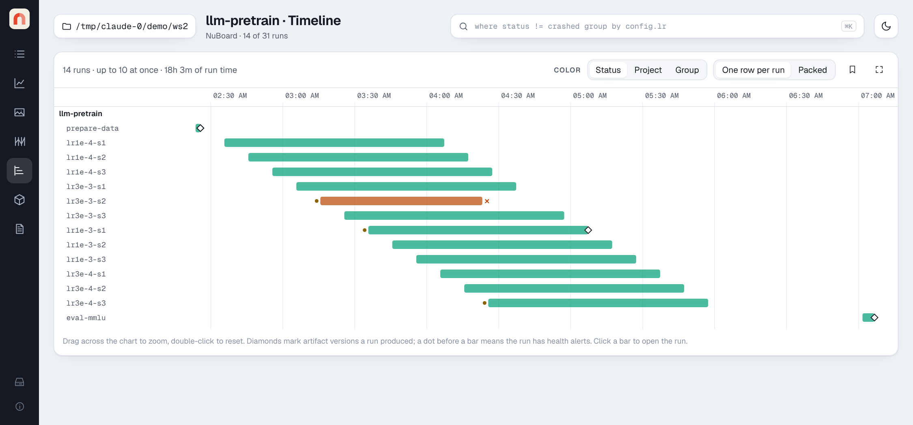

# Using the viewer

```bash
nuboard up ~/exp          # any folder: one run, one project, or many projects
```

The viewer is a single-page app served by a small local Starlette server. All
data stays on your machine. Every piece of view state (query, page, scalar,
x-axis, smoothing, zoom, selection, compared runs) is in the URL, so you can
bookmark a view, send the link to yourself on another machine, or save it as a
view file. Per-viewer preferences (theme, default smoothing) live in your
browser's local storage.

By default the viewer only answers on this machine (`127.0.0.1`). See
[Sharing on a network](#sharing-on-a-network) to open it to other machines.

{ .nb-shot }
{ .nb-shot }

## Header

- **Folder chip**: the served folder; click it to go back to all runs.
- **Query bar** (<kbd>Ctrl</kbd>/<kbd>⌘</kbd>+<kbd>K</kbd>): filters,
  groups and orders runs everywhere in the app. See the
  [query language](../reference/query.md).
- **Theme toggle**: light and dark themes; the default follows your system.
- **About** (the small ⓘ at the bottom of the side bar): the version, the
  copyright, the license and a link to this documentation.

## Runs page

- **Workspace** (left): every project found under the folder, with run counts,
  its collections and its saved views. **Save current view…** writes the
  current URL state to `<project>/views/<name>.json`, which you can commit.
  Click a view to open it. The **×** that appears on hover deletes a view or
  a collection, after asking; the runs themselves are not touched.
- **Table**: status, star, name and folder (with the run's collections and its
  tags as colored pills; a tag keeps its color everywhere), the config keys
  that differ between the listed runs, a result column, start time, duration, reviewed mark and
  notes. Pick the result scalar in the toolbar and switch between **Best**
  (min for losses and errors, max otherwise) and **Last**. Click a column
  header to sort. The list is virtualized, so thousands of runs scroll
  smoothly.
- **Filter box**: quick text filter on name, id, project, tags and notes.
- **Selection**: tick runs to **Star**, **Archive**, **Mark reviewed**,
  edit their **Tags…**, **Set property…**, **Add to collection…**, open them in
  **Charts**, **Sweeps** or **Media** (or press `c`, `s` or `m`), **Compare**
  up to eight of them, or **Plot selected**. Charts, Sweeps, Media and
  Timeline then show a **Showing N selected runs** banner with buttons to the
  other pages, which keep the selection, and **Show all**, which goes back to
  the query result; **Clear selection** ends it too.
- **Alerts**: a warning badge next to a run name counts its
  [health alerts](alerts.md). Hover it to read them; click it to open the
  run's chart.
- **Columns**: add columns for any scalar (last value), any config key, or
  a [property](#properties). The chosen columns are part of the URL.
- **Notes**: click a notes cell to edit it in place.
- Stars, notes, review marks, archive flags, tags edited in the viewer and
  property values are written to
  the run's own `annotations.json`, so they move with the run folder.
  Archived runs are hidden unless **Show archived** is on.

### Tags

Tags start as the ones passed to `nb.init(tags=...)` and can be changed in
the viewer at any time:

- In a run's details, the tag button next to its tags opens an editor: × removes
  a tag, and typing a name and pressing Enter adds one (tags used by other runs
  are suggested). **Done** or Esc closes it.
- To change many runs at once, select them and press **Tags…**. **Add** takes
  tags separated by commas or spaces, and **Remove** lists the selected runs'
  tags to pick from. Each run keeps its other tags.

Once a run's tags are edited in the viewer, the edited list replaces the
logged one, so a tag set in `nb.init` can be removed too. The logged tags stay
in `run.json` as they were; the edited list is kept in `annotations.json`.

### Properties

Properties are typed values you set on runs, such as a dataset, a verdict,
an owner or a link to a paper. A property is defined once per project, with a
type: text, number (with an optional unit), choice, tags, yes/no, date or
link. Each run then has its own value, checked against that type.

1. **Define one**: open **Columns** and press **New property…**, or press
   **Add property** in a run's **Properties** tab. Pick the name, the type,
   the options of a choice or tags property, and an optional description.
   From **Columns** the property is shown as a column right away, marked ✎.
2. **Set it on one run**: click a cell in its ✎ column (Enter saves, Esc
   cancels, an empty value clears it), or edit it in the run's
   **Properties** tab.
3. **Set it on many runs**: select them and press **Set property…**. Pick the
   property, then its value, with a control that fits the type: buttons for a
   choice or yes/no, pills for tags, a date picker for a date. A name that is
   not defined yet is defined first.

**Columns** lists every property of the listed projects, to show or hide.
Values written without a definition, such as with `Run.set_field` from
Python, are marked **Untyped**; in a run's **Properties** tab, **Untyped ·
define** gives such a property a type.

Properties work in queries (`verdict = "keep"`, `score > 3`,
`topics has "augmentation"`) and as sweep parameters. From Python, read them
as `run.fields` and write them with `run.set_field("verdict", "keep")` in the
[analysis API](analysis.md).

### Collections

A collection is a named, hand-picked set of runs, such as a shortlist or the
runs behind a paper figure. Select runs and press **Add to collection…**;
type an existing name to add to it. Collections are listed under their
project in the workspace; click one to filter to it (the query becomes
`collections has "shortlist"`), or hover it and press × to delete it (the
runs are not touched).

Each collection is a small JSON file, `<project>/collections/<name>.json`,
listing run ids, so it can be committed and survives moving the folder.

### Run details and compare

Click a run name to open its details above the table, with the run's tags
under its name (editable, see [Tags](#tags)): every setting (config,
git commit, host, Python, GPUs, world size, fork origin, artifacts used and
produced, last value of every scalar) and the run's files. A crashed
run shows its traceback.

**Console** shows what the script printed, captured into `files/output.log`
by [`capture_console`](../api/init.md#console-output). It opens at the end,
like a terminal, shows the last 2 MB of a longer log, redraws progress bars
on one line and draws color codes as colors (the 16 terminal colors follow
the light or dark theme; 256-color and true-color codes, bold, dim, italic
and underline are drawn too). **Raw** shows the text as stored, with each
escape character as `␛`. The file itself keeps the codes, so `less -R` in a
terminal shows the same colors.

**Files** lists everything in the run folder as a tree, with how many files
each folder holds and their size; `files/` (what `init` and
[`add_file`](../api/add_file.md) save, such as `config.yaml`, `git.patch`
and `command.txt`) starts open, other folders start folded. The tree is
about 12 rows tall and scrolls on its own; drag its corner to make it
taller. A long name loses its middle, so its end stays readable, and the
full path shows on hover. NuBoard's own data files (`run.json`,
`data.parquet`, event logs) are hidden until **NuBoard data** is switched
on. Pick a file to see it below the tree: text files are shown (diffed side
by side between two runs), images are drawn, and every file has a download
link. A text file with color codes or progress bars, such as a log, is
drawn like **Console**, with the same **Raw** switch, and diffed by its
visible text only.
Checkpoints (`.pt`, `.pth`, `.ckpt`, `.bin`, `.safetensors`, `.npy`,
`.npz`) list their keys as a tree with each tensor's shape, dtype and size,
and the total parameter count; with two runs the keys are diffed. Reading a
checkpoint needs no PyTorch and never runs code stored in it, and a file
that is cut off or malformed shows what could be read and why the rest
could not.

**Pins** turn files into tabs of their own, next to **Files**. The pin
button on a file (shown on hover) pins its path. A filter with `*` or `?`
is a pattern over whole paths (`*` within a folder, `**` across folders),
and **Pin pattern** pins it: `checkpoints/*/best_*.pth` shows each run's
own best checkpoint, newest first with a menu for the others, so runs whose
file names differ are still compared side by side. Pins are saved in
`<project>/pins.json`, so everyone viewing that data folder sees the same
tabs, in every run of the project; a pin only shows as a tab where a run has
a file it names. **Unpin** in a pinned tab, or the pin button in the tree,
removes it.

For a single run there are two more tabs:

- **Notes**: Markdown notes for the run, with a preview. Notes can use
  headings, lists, tables, links and code, and embed any logged item with
  the same `` line as a
  [report](reports.md). The runs table shows the first line; a note of more
  than one line opens here when clicked.
- **Properties**: the run's [properties](#properties). **Add property** defines one for
  the whole project, with a type picked from a menu: text, number (with an optional unit),
  choice, tags, yes/no, date or link. A choice is picked from a menu and tags
  are toggled as colored pills; neither accepts a value outside its options,
  which are added on purpose with **New option…** or **+ Option**. Numbers,
  dates and links are checked before saving, and the server rejects values
  that do not fit (from the table, the API or `Run.set_field` too). The bin
  button removes a property: its definition and its value on every run of the
  project. Values are saved in each run's `annotations.json`, so they show up
  as columns and work in queries (`verdict = "keep"`,
  `topics has "augmentation"`). Definitions are kept in
  `<project>/fields.json`.

**Charts**, **Sweeps** and **Media** after the tabs open those pages with
only the run (or the compared runs), as the selection bar does, without
ticking checkboxes.

With two to eight runs selected, **Compare** shows the same tabs side by side:
**All settings** has a column per run and highlights rows where any run
differs. **Files** and pinned tabs show a line diff between two of the
runs. With more than two, pick which two from the **Diff … against …** menus. **Only changes** hides
identical rows and lines.

The filter box above **All settings** narrows its rows by key, together with
**Only changes**, and shows how many keys are left (`12 of 340 keys`):

- Plain text matches part of a key, ignoring case: `edge.min`, `lr`.
- Text in slashes is a regular expression: `/^config\.generator\..*\.(min|max)$/`.
  The **.\*** button makes every term one. An invalid pattern turns the box
  red and leaves the list as it is.
- A leading `!` excludes keys, and terms separated by spaces must all match:
  `generator !debug`.
- **Values** also matches the values, to find which keys are set to `adamw`.

Matches are highlighted in the keys. `/` focuses the box and `Esc` clears it.
The filter is kept in the URL (`sfind=`), so it survives a reload and can be
shared.

## Charts page

{ .nb-shot }
{ .nb-shot }

The Charts page plots the selected runs (from **Plot selected** or **Charts**
in the selection bar) or, if none are selected, every run matching the query.

- **Summary cards**: best value of the focused scalar, running runs and last
  heartbeat, runs with NaN/Inf values, and how many runs are shown.
- **Grouping**: `group by config.optim.lr` in the query (or the **Group by**
  menu) draws one line per group with a band: mean ± std (default), mean ± sem,
  mean with min–max, or median with min–max (`agg` in the query, or the band
  menu). Runs are interpolated onto a shared x grid on the server before
  aggregating, so runs with different logging steps combine correctly.
  Without grouping, each run is one line (up to 60; group to see more).
- **Logged ranges**: a scalar logged with `low` and `high` (see
  [`add_scalar`](../api/add_scalar.md)) is drawn with a shaded band around
  each run's line, smoothed along with it, and the inspector shows the range
  after the value. When runs are grouped, the band is the spread across runs
  instead. The **Ranges** switch (shown when a chart has bands) hides every
  band when they clutter the chart; it is kept in the URL as `bands=0`.
- **Baselines**: a scalar with a reference value set with
  [`add_scalar_baseline`](../api/add_scalar_baseline.md) shows it as a dashed
  horizontal line, with a light band for its range. Runs with the same
  baseline (to 6 significant digits) share one gray line; a baseline only one
  run has is dashed in that run's color. Hiding a run hides its baseline, and
  highlighting a run highlights its baseline. Grouped charts draw the mean
  baseline of each group. The inspector lists each baseline with the runs it
  belongs to, the y-axis keeps every baseline in view, and the **Baseline**
  switch (shown when a run has one) turns them off.
- **Legend chips**: hover to highlight a series, click to hide it, and
  double-click (or Alt-click) to show only that series; soloing it again shows
  them all. **All** and **None** before the chips show or hide every series, so
  you can start from None and click the few you want. Each series has a color
  and a marker shape, so series stay distinguishable without color.
- **X axis**: step, wall time, relative time since the run started, or active
  time (relative time with pauses longer than five minutes removed). The
  **X by scalar** menu plots against any other scalar instead, such as
  `train/tokens` or `epoch`; counter-like scalars are listed first. The x
  scalar is matched to each point by step (interpolated when the two were
  logged at different steps), and zooming works as usual when the x scalar
  only grows. The choice is kept in the URL as `x=metric:<name>`.
- **Display row**: Smooth and the Raw, Ranges, Points, Baseline, Ignore
  outliers and Log y switches sit on their own row under the grouping and
  x-axis controls.
- **Smoothing**: debiased exponential moving average (as in TensorBoard). With
  **Raw** on, the unsmoothed data is drawn faintly behind the smoothed line.
- **Points**: a dot on each curve at the logged point under the cursor, so
  you can see where the real data points are (as in TensorBoard). When the
  cursor is pinned (click the chart), the dots stay. Kept in the URL as
  `dots=0` when off.
- **Ignore outliers** (TensorBoard's "Ignore outliers in chart scaling"):
  fits the y-axis to the 1st–99th percentile of the values, so a few spikes
  (such as a huge loss at step 0) do not flatten every curve. Off, the axis
  fits every point. **Log y** switches to a log scale.
- **Zoom and pan**: drag across a chart to zoom into a range. Over the
  focused chart, **Ctrl** (**⌘** on a Mac) + scroll, or a trackpad pinch,
  zooms in and out around the cursor, also past the ends of the data, with
  the y-axis fitted to what is in view. **Alt** + scroll zooms both axes, as
  in TensorBoard. **Shift** + drag pans in any direction, and **Shift** +
  scroll pans along x. The server sends a finer resolution for the x range
  (from the precomputed zoom levels in `data.parquet`, or from the raw log
  for live runs) once you stop, with some data on each side so smoothing
  does not restart at the edge; the view stays where you left it while it
  loads. Double-click, or **Reset zoom**, to reset.
- **Inspector**: hover a chart to see every series' value at that step,
  sorted best first, with ± std for grouped series. Click to pin the step.
  Without hovering it shows the latest values of the series shown (in the
  zoomed range).
- **Linked crosshair**: hovering any chart moves the crosshair on all of them.
- **Full screen**: the corner button above the focused chart (or Esc to
  leave) fills the screen with the chart and the inspector.
- **Add to a report**: the bookmark button above the focused chart saves it
  into a [report](reports.md), as it is shown: runs, grouping, smoothing,
  zoom and hidden series. The report draws it live and keeps a PNG copy for
  exports.
- **All scalars**: a small chart per scalar, grouped by prefix (`train/`,
  `eval/`, `perf/`…). Small charts load as you scroll. Click a title to bring
  the scalar into focus. **Grid** sets the charts per row (fit to width, or 1
  to 6) and the rows per section (1 to 6, or all); a section with more charts
  gets a pager. Both are remembered and kept in the URL (`ccols`, `crows`).
  **Filter scalars** takes a regular expression (as in TensorBoard, case
  insensitive; `loss|acc`, `^train/`) and shows only the matching charts; it
  is kept in the URL as `cfind`.
- A run that logged NaN gets a dashed marker at the first NaN with a
  `NaN · run` label.
- **Live**: while runs are running, the server pushes updates over
  Server-Sent Events and the charts redraw at most every two seconds. They
  hold still while you work with them: when the chart is zoomed, the cursor
  is pinned or you hover a chart, or when the **Live** switch is off, new
  points wait behind a **New data · Update** button. Hovering away from an
  unzoomed, unpinned chart draws them by itself.

- **Alerts strip**: under the focused chart, the
  [health alerts](alerts.md) of the runs in view. Click one to jump to it;
  spikes and drops are shaded on the chart.

## Live updates

The server checks the folder every 1.5 s and pushes changes. The **Runs** page
follows them as they come: values change in place, and rows do not move while
the pointer is over the table. Open run details follow the run's status,
duration and summary, and read the run once more when it finishes or crashes.
**Charts** behave as described above. **Media**, **Sweeps**, **Timeline**,
**Artifacts** and **Reports** do not change under you: when runs change, a
**New results · Refresh** button appears next to the page title (changes that
are only heartbeats are ignored). Going back to Runs or Charts catches up by
itself.

## Sweeps page

Parallel coordinates over the parameters that vary between runs, with brushing
on every axis, a grid of scatters (one per parameter) and a best-runs table.
The main chart can go full screen, and any plot can be added to a report. See
[Sweeps](sweeps.md).

## Timeline page

{ .nb-shot }

Every run as a bar from start to end, grouped by project, colored by status,
project or group. Each row shows the run's name followed by the end of its id,
which tells apart runs with the same name; hover a bar for the full id. **Packed** puts runs that never overlap on the same row, so
the chart shows how many ran at once; the summary line gives the peak and the
total run time. Crashed runs end in ✕, runs with alerts have a dot, and
diamonds mark artifact versions a run produced. Click a bar to open the run.

To move around in time: **Day**, **Week**, **Month** and **Year** show that
much time up to the latest activity, **‹** and **›** step one window back or
forward, and **All** fits every run. Drag across the chart to zoom into a
range, **Ctrl** (**⌘**) + scroll (or a pinch) zooms around the cursor, and
**Shift** + scroll, a sideways scroll or **Shift** + drag moves along time.
Double-click fits every run again. The axis switches to months and years for
long ranges. The corner button
shows the timeline full screen (Esc leaves), and the bookmark button adds it
to a [report](reports.md) as a snapshot.

## Artifacts page

Every artifact version with its files, metadata and a lineage graph of the
runs that produced and used it. Started with `--edit-artifacts`, the page can
also add a version from a path and unlink or restore versions. See
[Artifacts and lineage](artifacts.md#adding-and-unlinking-versions-in-the-viewer).
The disk button at the top of the list opens [Storage](#storage) on its
Artifacts tab.

## Reports page

Lists the Markdown reports of every project, with an editor and a live
preview side by side. See [Reports](reports.md).

## Media page

Shows images, audio, video, figures, point clouds, HTML and text logged with
`add_image`, `add_audio`, `add_video`, `add_figure`, `add_pr_curve`, `add_histogram`, `add_table`,
`add_point_cloud`, `add_html` and `add_text`, for the selected runs (or
the query result, up to 48 runs). Each key is a collapsible section with a card
per run; every card has its own step slider, as in TensorBoard, so one run can
be scrolled through its steps while the others stay put.

- **Runs**: a chip per run, as in the Charts legend. Click one to hide or
  show it, double-click (or Alt-click) to show only that run, and **All** or
  **None** to show or hide every run.
- **Kinds**: the chips below (Images, Audio, Video, Figures, Tables, Point clouds, HTML, Text) show or
  hide a kind of media; double-click one to show only that kind. The number
  on each chip counts its keys.
- **Filter keys**: a regular expression on the keys, such as `^eval/` or
  `confusion|per_class`. While it is set, the count next to it shows how many
  keys match, and keys that do not match are hidden.
- **By key / by run**: a section per key with a card per run (default), or a
  section per run with a card per key.
- **Step**: **Latest** shows each run's last item; **Pick step** moves every
  card to the item at or before one step; **Best scalar** moves each run to
  the item closest to the step where a scalar of your choice was lowest or
  highest (for example the best `val/acc`). Moving a card's own slider
  overrides the page-wide step for that card only.
- **Grid**: **Columns** sets the cards per row (fit to width, or 1 to 8) and
  **Rows** how many rows each section shows per page (1 to 6, or all); a
  section with more cards gets a pager. Both are remembered.
- **Expand all** and **Collapse all** fold the sections; with many keys only
  the first three start open. **Show runs without the key** adds an empty
  card for runs that never logged it.

Each card can open its item large, download it, or **add it to a report**
(the bookmark button). **Select for report** adds a checkbox to every card
so several items go into a report at once; see [Reports](reports.md). The whole view is kept in
the URL (`mkinds`, `mfind`, `mby`, `mmode`, `mstep`, `mmetric`, `mdir`,
`mcols`, `mrows`), so a shared link shows the same grid.

Logged HTML runs in a sandboxed iframe (`sandbox="allow-scripts"`, no
same-origin access) and is served with a matching `Content-Security-Policy`.
**Output / code** above it switches to the HTML source, with line numbers.
Matplotlib figures are stored as SVG and shown as images. Plotly, Vega-Lite
and Bokeh figures are interactive (hover, zoom, pan, export), each in its own
sandboxed iframe, and follow the light or dark theme. Every figure also has a
**Download spec** link for the raw JSON.

| Library | Rendered with | Network |
| --- | --- | --- |
| Plotly | plotly.js 4, bundled with the viewer | none |
| Altair / Vega-Lite | Vega 6, Vega-Lite 6 and vega-embed, bundled | none |
| Bokeh | BokehJS from `cdn.bokeh.org`, for the exact version that wrote the figure | needed when viewing |
| `nb.WaveformFigure` | uPlot, bundled (as on the Charts page) | none |

The bundled renderers load only when a figure of that kind is on screen.
BokehJS has to match the Python Bokeh version, so it cannot be bundled; when
the CDN is unreachable the figure shows a message and the spec stays
downloadable.

### Waveform figures

A waveform logged with `add_figure(key, nb.WaveformFigure(audio, rate,
signals))` is drawn as a plot of the samples with each signal over it, accurate
at every zoom: each pixel column draws the first, smallest, largest and last
sample under it, recomputed as you zoom, so long files stay fast and single
samples show when zoomed in. Hovering shows the time, sample index and exact
values, and the label of each region track logged with the figure (drawn in
lanes under the plot, a row per class where classes overlap). Drag to select a
section, then loop it, zoom to it or add a **Note**; notes show in a lane above
the plot and are saved like audio notes. − / + / **Fit**, Ctrl/⌘ + wheel and
double-click zoom, Shift + wheel scrolls, and the overview below the plot moves
the view. The full screen button (next to **Fit**) spreads the figure over the
window with a taller plot, in the viewer and in exported reports alike; there
Space plays and pauses, and Esc puts it back. The play button plays the clip, or the selection, from where you
click. The download button next to it saves the **Audio (.wav)** as logged or
the **Data (.zip)**: the audio, one `.npy` per signal and a `metadata.json`
([details](../api/add_figure.md#downloading-the-audio-and-signals)). Other
items download from their card with an extension that matches their type
(`.png`, `.wav`, `.json`, ...). It has no spectrogram; [Audio](#audio) has that. See
[`add_figure`](../api/add_figure.md#waveforms-with-signals).

### Tables

Tables (`add_table`) take the whole width of the section. Each run's card has
its step slider, and every number is compared with the same row at the
**Previous step** or the **First step** (or **Nothing**): the cell is tinted
green when it got better and orange when it got worse, darker for bigger
changes, with the change next to the value (**Color + Δ**, **Color** or
**Δ**). A column counts as better when lower if its name looks like a loss or
error (`loss`, `error`, `wer`, ...), and when higher otherwise; the arrow next
to each column name says which.

- Click a column to sort; rows glide to their new place when the step changes,
  and the arrows next to the rank say how many places a row moved.
- **Filter rows** takes comparisons joined with `and`, such as
  `snr_in < 0 and noise = babble`; other text matches the row id.
- The summary counts the rows that improved or got worse on the sorted column
  (or the first column that changed), with its mean and change.
- **Trend** draws that column for each row across the logged steps.
- Click a row for its values at every step and its media: an audio cell opens
  in the waveform player, with notes.

In an HTML export a table shows its first 200 rows, colored by the change
since the previous step.

### PR curves

PR curves are listed with the figures. Each card draws its run's curve
(precision against recall) in the run's color with its average precision
(AP, the area under the curve, by the trapezoidal rule), and a chart above the
cards overlays every run's curve at the chosen step, as TensorBoard does; its
buttons open it large, download it as a PNG with its legend, or add it to a
report. Hover a curve for the threshold, precision,
recall and the TP, FP, TN and FN counts there.

### Distributions

Distributions (`add_histogram`) are listed with the figures. Each card draws
its run's histogram at the chosen step, filled in the run's color, with the
step logged before it as a dashed outline, so you see how it moved. The y axis
is density, so steps and runs with different ranges or bin counts compare
fairly. Hover for the bin under the pointer and its share of the values.
**Over steps** switches the card to TensorBoard's distributions view: the
median as a line and bands holding 68%, 86% and all of the values at every
logged step (up to 150, sampled evenly), with the chosen step marked. A chart
above the cards overlays every run's histogram at the chosen step; its
buttons open it large, download it as a PNG with its legend, or add it to a
report. In an HTML
export a distribution is drawn as a picture with the step before it.

### Point clouds

Point clouds are drawn in a view you can rotate (drag), pan (shift-drag or
right-drag), zoom (click the view, then scroll) and reset (double-click),
colored by their logged colors or else by height. **Axes** under the view
draws the x, y and z axes from the cloud's lowest corner, with round values
along them; they start shown when the cloud was logged with `axes`, labeled
with its names. Each card has its step
slider, so you can watch a cloud change over training; the zoomed view draws
it larger. The renderer is a few hundred lines of plain canvas code, so it
needs no WebGL and works the same in an HTML export.

### Video

A clip logged from frames ([`add_video`](../api/add_video.md) with an array)
plays in a frame player: play and pause, a slider to step through the frames
one at a time (it pauses playback), and the frame number and frame rate. It
loops, as TensorBoard's does. MP4, WebM, MOV and Ogg files play in the
browser's own video player, muted and looping, with its controls. Moving the
card's step slider shows the clip of another step, so you can watch a policy
or a generator improve over training.

### Audio

Audio has two players, switched with **Audio** above the grid (the choice is
remembered):

- **Waveform** (default): waveform and spectrogram of every channel, with a
  minimap, time ruler, zoom (buttons, slider, `+`/`-`, or Ctrl + wheel),
  drag-to-select with loop (`L`) and zoom-to-selection (`Z`), playback speed,
  and full screen (`F`), where Space plays and pauses. The spectrogram is computed in the browser (Hann
  window of 1024 samples, levels in dB relative to a full-scale sine on a
  fixed scale, so clips can be compared by eye). The players of one key
  follow each other's zoom, scroll, cursor and selection, and starting one
  pauses the others, so you can listen to the same passage across runs.
  Space plays and pauses; arrow keys seek. Next to the player switch,
  **Colors** picks the spectrogram colormap (theme, viridis, magma or gray),
  **Frequency** its scale (linear, log or mel), **Window** the FFT size (256
  to 4096 samples; the hop is a quarter of it), and **Spectrogram** hides it
  to show only waveforms. **Amplitude axis** labels the waveform's amplitude
  (±1 is full scale) down its left edge. The choices are remembered in the
  browser and kept in the URL (`cmap`, `fscale`, `fft`, `spec`, `amp`), so a
  shared link shows the
  same view.
- **Simple**: the browser's own audio controls, as in TensorBoard.

**Notes**: in the waveform player, select a section and press **Note** (or
`N`), type, and press Enter. Notes show in a lane above the waveform; click
one to select its section again, then **Edit note** changes or deletes it.
Notes are saved in the run's `annotations.json` (keyed by the media key and
step), so they show wherever the clip does, including reports, and an HTML
export lists them under the clip with buttons that play each section. From
Python, `Run.audio_notes` reads them.

Each clip shows its caption, duration, sample rate and channels, and a
download link. The waveform player is a port of the player in
audioviewer, built on
[wavesurfer.js](https://wavesurfer.xyz) (BSD-3), bundled with the viewer
so it works offline.

## Storage

The disk button at the bottom of the left rail shows how much disk the served
folder uses, like a system storage panel. Nothing is measured until you press
**Measure**, and the result stays until you press **Refresh**, with the time
it was measured. It is kept across restarts of the viewer.

- **Runs** shows one bar for the whole folder, split into runs, artifacts and
  other files (reports, views, ...), then every project by size. Open a
  project to see its largest runs, each split into scalars, media, files and
  console output; click a run to open it.
- **Artifacts** lists each artifact with its versions. Only what is stored in
  the folder counts: a copied version counts its files, a referenced version
  only its manifest. The size a reference points to is shown apart, as
  "points to … elsewhere".

Measuring only lists folders and reads file sizes; it never opens a file, and
a symlink counts as the link, not what it points to. On a very large folder it
pauses after 10 s and asks whether to go on; **Stop here** keeps what was
measured so far, marked as partial.

## Sharing on a network

`nuboard up --host 0.0.0.0` (or a specific address) makes the viewer reachable
from other machines, and anyone who reaches it could read your runs and change
notes, tags and reports. So, like Jupyter, it then asks for a token:

```text
$ nuboard up ~/exp --host 0.0.0.0
nuboard serving ~/exp (31 runs) at http://gpu-box:6070/?token=3f9c…e1  (Ctrl+C to stop)
  Open the link above once per browser; it signs the browser in.
```

- Opening the link signs the browser in with a cookie for 30 days and removes
  the token from the address bar. Without it, pages show a sign-in form where
  the token can be pasted, and API calls get a 401.
- A new random token is made each start. `--token VALUE` or the
  `NUBOARD_TOKEN` environment variable sets a fixed one, so bookmarks keep
  working. `--no-token` turns it off, for a network you trust.
- Scripts send `Authorization: token VALUE`.
- On `127.0.0.1` there is no token, as before. You can still ask for one with
  `--token`.

Whatever the host, the viewer refuses changes that a page of another website
tries to make through your browser.

The token travels in plain HTTP. On an untrusted network, keep the default
host and forward the port with `ssh -L 6070:localhost:6070 gpu-box` instead.
Artifacts stay read-only unless you add `--edit-artifacts`. Reports can be
edited and take uploads unless you add `--read-only-reports`.
