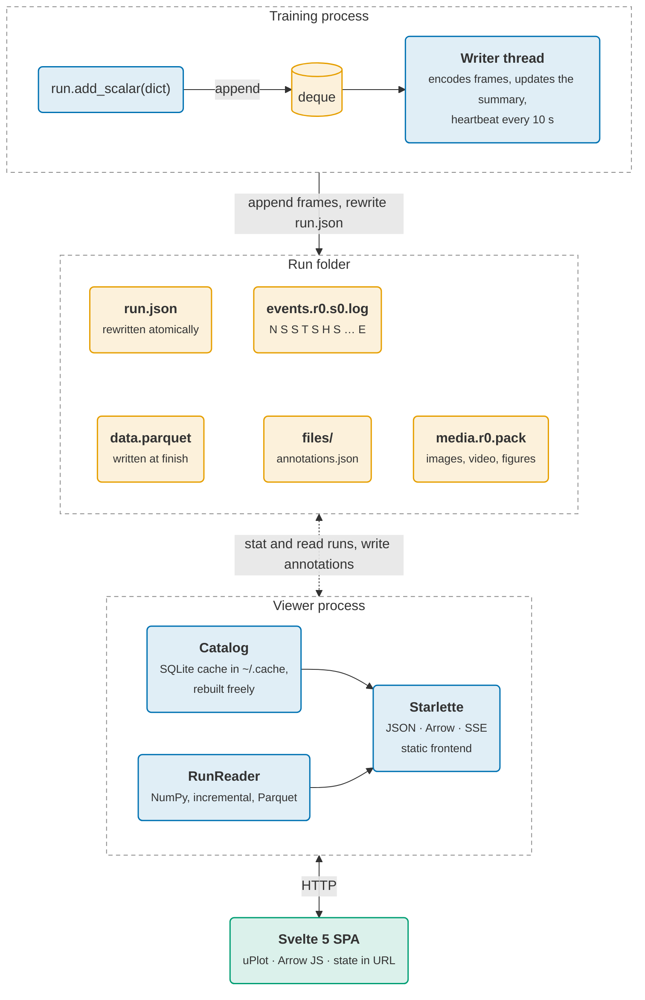

# Architecture

## Logging side (`run.py`, `_writer.py`, `_format.py`, `_env.py`, `_media.py`, `artifacts.py`)

Standard library only, so `pip install nuboard` adds nothing to a training
environment.

- `add_scalar()` resolves the step, then appends `(kind, step, time, dict(data))` to a
  `collections.deque`. That is the whole cost on the training thread: no
  locks, no conversion, no I/O.
- A daemon writer thread wakes every second (or on `flush()`), drains the
  deque, flattens nested dicts, converts values to float (this is where a
  tensor's `.item()` runs), assigns scalar ids, updates the running summary
  (last/min/max/count/non-finite) and writes one `S` frame holding four
  columns for the whole batch, preceded by any new `N` frames. Columns are
  encoded with `array.array`, byte-swapped on big-endian machines.
- Every 10 s the thread writes a heartbeat frame and rewrites `run.json`
  (summary + heartbeat) atomically.
- `finish()` (also via `atexit`, the exception hook and context managers)
  drains, writes an end frame, fsyncs and marks the status. Compaction runs
  afterwards if PyArrow is importable.

## Reading (`reader.py`, `compact.py`, `series.py`, `alerts.py`)

- `LogFile` keeps a byte offset per log file and decodes only the bytes
  appended since the last call. Frames are walked with `struct`; scalar
  payloads become NumPy views via `np.frombuffer`. Per-scalar arrays come from
  one stable argsort on scalar ids (a radix sort, since ids fit in 8 or 16 bits).
- `RunReader` merges sessions (later session wins) and prefers
  `data.parquet` when its recorded log sizes match the current ones.
- `compact.py` writes zoom levels (8× downsampling per level, mean plus
  min/max envelope) with one row group per (scalar, level).
- `series.py` holds the NumPy math: equal-count bucketing, x-axis
  transforms (step, wall time, relative, active time), and group aggregation
  (interpolate each run onto a shared grid of about one or two points per
  pixel, then mean/std/min/max/median per grid point, ignoring NaN).
- `alerts.py` runs the health checks on at most 2,000 buckets per scalar:
  first non-finite value, spikes against a trailing median and MAD, and
  sustained drops below a fraction of the median. `compact_run` stores the
  result in `run.json`; the server computes it live for running runs and
  caches it by log size.

## Viewer server (`catalog.py`, `query.py`, `collection.py`, `server/`)

- `Catalog` walks the folder for `*/runs/*/run.json` (string-based
  `os.scandir`, no pathlib in the hot loop), stats `run.json` and the run
  folder (annotations are replaced atomically, which bumps the folder's
  mtime), and re-reads only what changed. Records are cached in SQLite on
  local disk so a restart does not re-read thousands of `run.json` files.
- `collection.py` reads and writes `<project>/collections/*.json`; the
  catalog attaches each run's collections to its record on every list, with
  the membership cached on the files' mtimes.
- `query.py` is a small recursive-descent parser for the query language;
  filtering and ordering run in Python over catalog records.
- `server/data.py` keeps an LRU of `RunReader`s, picks a Parquet zoom level
  from the requested point count and visible range, and returns chart data as
  an Arrow IPC stream (`series, x, y, lo, hi` columns plus series metadata in
  the schema).
- `server/app.py` has the routes, gzip, a localhost-only host check, and one
  background task that polls for changes every 1.5 s and fans them out to all
  open browser tabs over Server-Sent Events (`runs` when metadata changed,
  `data` when a live run's logs grew).

## Frontend (`frontend/`)

Svelte 5 with runes and strict TypeScript, built by Vite into
`src/nuboard/static/` so the wheel ships it.

- `lib/router.svelte.ts`: all view state in the URL hash.
- `lib/state.svelte.ts`: info, run list, collections and selection.
- `lib/sweep.ts`: axes, scales and parameter importance for Sweeps.
- `lib/api.ts`: fetch helpers; Arrow decoding with `apache-arrow`.
- `components/LineChart.svelte`: uPlot with joined x arrays, bands,
  smoothing, robust y range, NaN markers, drag-to-zoom and cursor sync.
- `pages/`: Runs, Charts, Media, Sweeps, Timeline, Artifacts. The new pages
  draw plain SVG; no chart library beyond uPlot is needed. Styling uses Tailwind v4 with the design
  tokens of the Studio mockup (Okabe–Ito based, light and dark).

## Performance

Measured with `benchmarks/bench.py` in the (slow, shared) container this
version was built in; a laptop is typically 2–3× faster.

| Target | Measured |
| --- | --- |
| `add_scalar()` of a 50-scalar dict well under 50 µs | ~2.5 µs |
| 1M scalar points: under 30 MB live | 28 MB of event log |
| 1M points: under 0.1 s to read | 0.12–0.15 s (decode 0.04 s, per-scalar split the rest) |
| one scalar from Parquet under 10 ms | ~7 ms warm, ~60 ms for the first read after opening |
| run list of 5,000 runs under 200 ms | ~65–100 ms per refresh; ~0.35 s to open the cached catalog at server start |

The background writer handles roughly 600–700k points per second in this
container, far above typical logging rates; if a loop logs faster than that
for a sustained period, the queue grows in memory.

## Deliberate choices

- **No DuckDB, no database server.** NumPy and PyArrow do the math; SQLite is
  only a local cache.
- **No locks on the write path.** One writer per (rank, session) file; readers
  tolerate torn frames.
- **No SQLite on network filesystems.** The catalog lives in the user's cache
  folder.
- **Name in one place.** `pyproject.toml`, the `src/nuboard/` folder and
  `frontend/src/lib/brand.ts`; everything else derives from
  `nuboard._meta.NAME`. See [Development](development.md#renaming).
